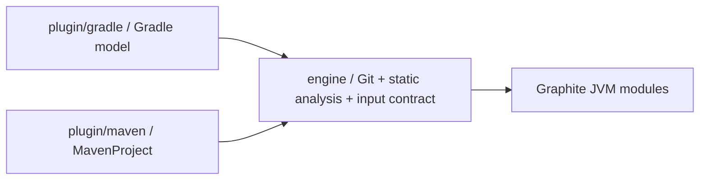
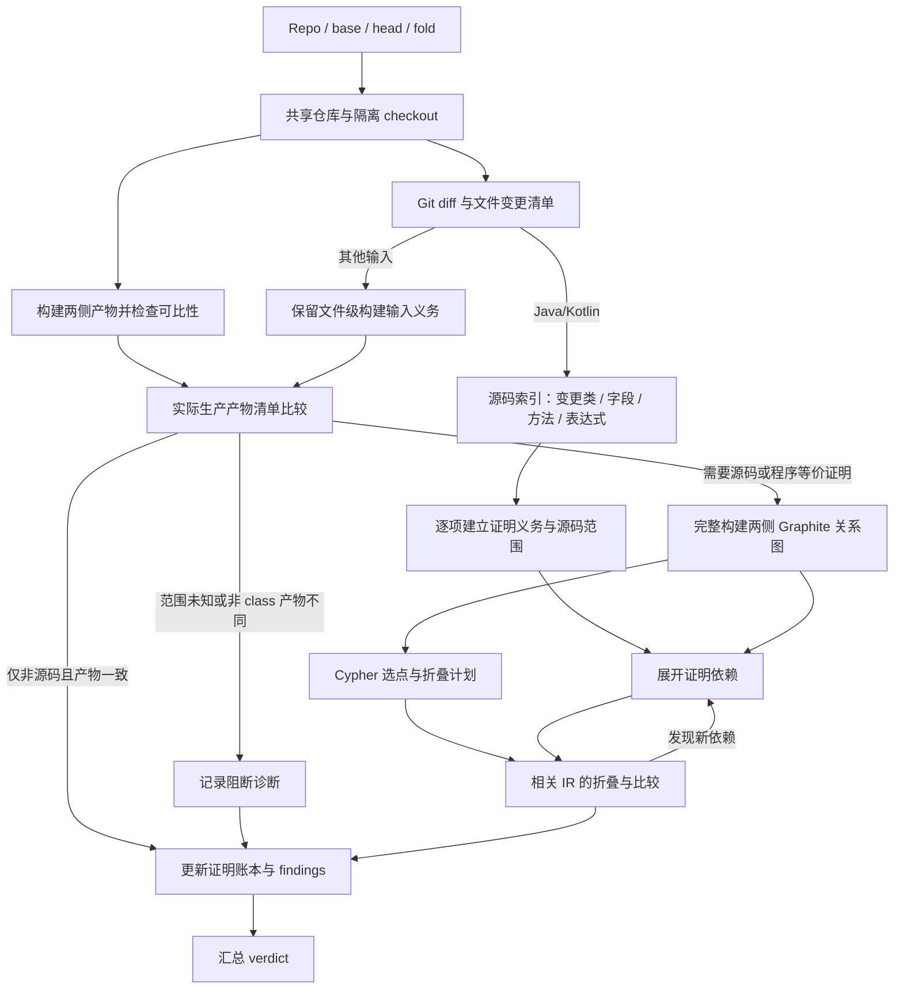

# GraphFold 设计文档

状态：设计与实现并行收敛。已实现 engine、Gradle plugin、Maven plugin，并扩展 Java/Kotlin 检测与解释能力；扩展后的全量回归仍在验证。已执行证据见 [validation.md](validation.md)，旧版本验收不能替代新增能力的验证。本文中的目标能力不等于已经交付的保证，当前边界见第 18 节。

初稿日期：2026-10-30；Graphite observer 接入更新：2026-11-07。

Graphite 上游需求与交付状态见 [dependency-aware proof problem statement](graphite-problem-statement.md)。当前目标依赖为 `2.15.0`，采用同次建图的 folded-body observer、结构化 completeness 与 method receipts。当前依赖正式发布的 Maven 制品；历史 alpha1 隔离源码构建记录与当前回归、覆盖率及 CI 验收见 [validation.md](validation.md)。

## 1. 目标与判定契约

GraphFold 检查一次 Git 变更是否受指定的折叠条件控制。给定仓库、base commit、head commit 和折叠规则，引擎先从 diff 识别变更的类、字段、方法和表达式，为每项变化建立证明义务；再利用 Graphite 展开证明依赖，在相同假定下折叠相关 IR，检测仍然存活的 uncontrolled change，并报告精确源码位置。

**主架构：Diff 建立证明义务，Graphite 提供全局关系，折叠后的 IR 完成证明。** 不是先寻找全程序差异再筛选 diff，也不是只分析改过的方法。首版完整构建两侧分析范围内的程序图，以 diff 驱动依赖展开和深入比较；增量建图留待后续验证。

核心不依赖 AB testing。`K_PR` 表示控制本次变更的机制，`A_PR` 表示用户为它声明的基线状态假定。AB ID、feature flag、配置开关等都可以通过适配转换为折叠规则。

目标不变量：

```text
fold(head, A_PR) ≡ fold(base, A_PR)
```

`≡` 是目标语义，不是对任意程序都可自动判定的承诺。实现通过完整程度受检查的程序表示、保守折叠和明确支持的等价规则证明该不变量。不能证明时失败，不能把图相同或没有 finding 当作证明。

门禁只有两个 verdict：

| Verdict | 条件 |
| --- | --- |
| `PASS` | 分析成功完成，本次所有相关变化均被证明消除或等价 |
| `FAIL` | 存在缺乏充分安全证明的 uncontrolled change，或存在阻止完成证明的错误、缺口或定位失败 |

`FAIL` 区分未受 control 约束的静态生产代码差异、证据不足的变更和分析过程错误；它不声称已经发生运行时业务行为差异。

### 1.1 变更归属

Violation 必须来自指定 base 与 head 的 diff。分析可以访问整个程序，报告不能把未修改代码算作本次新增的问题。

- 新增、修改定位到 head 的实际变更范围。
- 删除定位到 base 的实际删除范围。
- hunk 中的未修改上下文不属于变更。
- 未修改的调用者或 helper 可以作为证据，不作为 finding 的主归属位置。
- 不能仅因方法范围与 diff 相交，就认定该方法里的某项修改违规。
- 不得将无法归因的剩余差异静默丢弃；它成为阻断诊断，仍然 `FAIL`。

计算指定 `base..head` 的树差异，不自动替换成 merge-base。base 是生产版本还是目标分支由调用方决定。

### 1.2 AB 场景的映射

AB 是一个外部适配场景：PR title 中的 JIRA ticket 可以用于查询自定义字段中的一组 AB IDs，再生成规则。核心不访问 JIRA，也不从源码猜测本次 PR 的 ID。

- 单个 PR 可以声明多个 AB ID。
- A 和 NA 都属于 control。若两者产生不同执行路径，需要分别验证相关场景。
- 多个控制点应在同一场景中共同折叠，不能用分别关闭单个控制点的结果代替。
- 若有多个 control 取值，默认验证其组合；只有证明场景独立或等价后才能减少组合。超过资源预算必须失败，不能抽样后通过。
- 未声明的 ID 不参与折叠。
- NoLog 表示不发送曝光日志，但不形成额外判定规则。
- 不设置独立曝光签名、曝光差异门禁或“AB 相关日志自动豁免”。日志和其他操作一样，按其变化是否在折叠后仍存在判断。

普通变化采用上述不变量。AB clean、移除开关后的赢家收口需要不同的不变量，不纳入首版自动判定；未来应通过明确的比较模式扩展，不能隐式猜测。

## 2. 工程与职责边界

多模块 Kotlin 工程，包名前缀统一为 `io.johnsonlee.graphfold`，引擎模块使用 `io.johnsonlee.graphfold.engine`。



| 模块 | 职责 |
| --- | --- |
| `engine` | Git fetch/checkout/diff，消费准备好的静态输入，建图、control 折叠、比较、源码归因和 verdict；不了解构建工具 |
| `plugin/gradle` | 读取当前进程的 Gradle 项目、source sets、归档任务、依赖和编译输出；不启动 gradlew 或 init script |
| `plugin/maven` | 读取当前生命周期的 MavenProject/MavenSession；不启动外部 mvn |
| `gfc` | javac/Kotlin 编译来源提供器，拥有 Java-only 来源协议；engine 依赖并消费该协议，gfc 不依赖 engine |

各集成入口只依赖 engine，不互相依赖。构建工具无关的归档解码、MR 选择和输入快照准备属于 engine 的 `engine.inputs`，只在 engine 中编译一次。插件只负责从原生构建模型提取输入，不通过 `srcDir` 共享实现或测试。不存在共享的构建工具自动探测或启动模块。
插件在各 revision 的正常构建中导出不可变字节码快照和源码关联；engine 通过 Git 获得
两端源码和 diff，然后比较两端输入，不能在 checkout 后复用另一个 revision 的构建模型。

BASE 和 HEAD 两侧输入都必须由可信、受控的构建流程从对应提交生成，并保存在 PR 无法替换的制品存储中。
构建和导出配置本身也必须受信任；仅把 PR 可控制的导出程序放进 CI 执行并不能认证其输出。
不能把随 PR 提供的快照 manifest 或 assets 当作构建来源证据。manifest 内的摘要只能检测相对该
manifest 的损坏或修改；攻击者同时替换 assets 和摘要仍会通过，因此它不是身份认证或源码到
字节码的来源证明。Git SHA 校验也不能单独证明任意归档来自该提交。导出拒绝未提交的 tracked
变更和未忽略的 untracked 文件；正常构建产物应由 `.gitignore` 忽略，不能因此忽略生产源码。
详见 README 的 [快照信任边界](../README.md#snapshot-trust-boundary)。

输入契约保留 `sourceRoots`、`sourceOutputs`、`sourceClasspaths`、声明的 source sets
及可选 compiler evidence。Gradle/Maven 插件提供构建模型中的源码根、输出和 classpath 关联；
当前不会自动启用 gfc，也不会自动采集或导出其 sidecar、runId 和 compiler evidence。
显式提供的编译来源证据由输入契约承载，并由 engine 校验。
无来源记录时仍执行完整原始字节码折叠；源码关联仅解释和定位差异，不能代替完整比较
或授权忽略没有 control 覆盖的修改。缺失映射降低归因精度，不阻止建图和折叠。

所有模块同版本发布。engine 不依赖 Gradle/Maven API 或编译器 provider。
插件源码位于 `plugin/gradle`、`plugin/maven`，Gradle 项目路径为 `:plugin:gradle`、`:plugin:maven`；发布 artifact ID 仍为 `gradle-plugin`、`maven-plugin`。
gfc 的 compiler hooks 使用宿主编译器 API。测试中的 fixture 编译器不属于 engine 生产实现。

GFC 在真实编译完成后记录 emitted class 的 SHA-256。Kotlin 使用编译器输出回调提供的实际 class 路径；
javac 的 `GraphFoldOrigins` 插件接收第四个 Base64 URL 编码参数，即与 `-d` 一致的 class 输出目录，
或由调用方使用接受该目录的 `attach` 重载。旧三参数调用只提供未绑定 class hash 的来源记录，
不能满足 `requireOriginClassHashes` 的严格 prepared input 校验。插件默认源码模型关联与可选 GFC
接入是不同契约；默认 Gradle/Maven 入口不会自动启用 GFC，也不据此宣称已提供 compiler origins。

### 引擎内部分析职责

`engine.snapshot` 保存 GraphFold 的静态比较证据，不依赖 Graphite 适配器。
`engine.bytecode.asm` 负责 ASM 字节码清单、JVM 元数据、初始化、逃逸和目标声明证明；
`engine.bytecode.sootup` 负责 SootUp 方法表示、资源与 lambda 证据、曝光条件证明和规范化。
`engine.graphite` 只负责 Graphite 加载与查询、选点、完整性证据、审计及观察回调的转换。
回调收集器把方法体交给字节码分析代码，产出 snapshot；比较与 verdict 消费 snapshot，
不会反向依赖这些收集器。预折叠调用证据由适配器提取，再交给 engine 的同输入 control 覆盖证明。

## 3. 输入与输出

### 3.1 请求

插件为每个 revision 导出不可变静态输入，集成层解码为 `PreparedRevision`。公开 engine API 接收两版准备好的输入与规则：

```kotlin
val comparison = engine.prepare(baseRevision, headRevision, fold)
val result = engine.analyze(comparison)
```

engine 校验 revision 的 Git 身份并从 commit tree 计算 diff；调用方不能提供过滤后的变更列表。`PreparedComparison` 是 engine 生成的不透明比较请求，`ChangedFile` 是内部类型，其中变更类型与编辑坐标直接使用 JGit 的 `DiffEntry.ChangeType`、`Edit`。`RepositoryConfiguration` 管理仓库缓存和工作区预算；`EngineConfiguration` 提供分析缓存与场景数量限制，均不管理构建工具。

`fold` 当前传入 YAML 文档内容：Graphite 的 `select` 返回调用点，替换值通过独立 `value` 提供；纯查询字符串不足以表达完整假定。引擎沿用 Graphite 规则结构，并接受场景集合：

```yaml
scenarios:
  - name: baseline
    folds:
      - select: |
          MATCH (cs:CallSite {callee_class: 'example.Flags', callee_name: 'enabled'})
          RETURN cs
        args:
          0: checkout_v2
        value: false
```

这是同一个 fold 输入内部的结构。单场景直接接受 `version: 1` 与 `folds`；多场景使用上述 `scenarios` 包装，每个场景均须通过。默认最多 32 个场景，超过上限阻断。YAML 必须是单一对象文档；语法错误、重复键、额外文档、未知属性、非法版本及规则结构在实际图分析之前阻断，错误包含场景/规则索引。规则字段由 Graphite 的解析器校验，Cypher 语法和返回类型则在实际图上执行查询时校验。

规则表达的是用户授权的假定；过宽的查询也会产生过宽的假定。引擎记录实际选点供审计，并验证规则中的参数约束，但不能凭业务知识证明用户声明的假定正确。

有限的预定义状态和 code 在内部使用 enum；外部 JSON 与构建协议中的字符串在边界解析/编码。该约定也适用于 Git 变更类型、Gradle 导出记录类型、编译器来源类型/前端、方法修饰符和报告格式。Git rename/copy 的相似度是独立数值，不编码进类型字符串。未知协议标签会显式拒绝，不静默忽略。路径、符号名、JVM 描述符及自由文本诊断仍是字符串。

| 内部领域 | 类型 | 外部表示 |
| --- | --- | --- |
| diagnostic code | `DiagnosticCode` | 既有大写 code 名称 |
| Git 文件变化 | JGit `DiffEntry.ChangeType` | rename/copy 相似度单独保存在 `similarityScore` |
| Gradle 导出记录 | `GradleInputKind` | 保留 `classes` / `source` / `dependency` / `sourceOutput` 标签 |
| 编译器与来源 | `OriginProtocol` 中的 compiler/backend/frontend/kind/provenance enums | 保留原 manifest 与 bytecode marker 值；共享类型只依赖 JDK |
| 方法修饰符 | SootUp `MethodModifier` | 仅生成 canonical 文本时按名称排序并编码 |
| 来源对齐版本 | `Revision` | 诊断文字和既有 hash 输入仍编码为小写 base/head |

### 3.2 结果模型

以下展示已实现模型的核心字段；完整定义以 engine 的 `AnalysisModel.kt` 为准：

```kotlin
enum class Verdict { PASS, FAIL }
enum class Revision { BASE, HEAD }
enum class FindingKind { UNCONTROLLED_CHANGE, UNVERIFIABLE_CHANGE }

data class SourceRange(val start: Int, val end: Int)

data class SourceLocation(
    val revision: Revision,
    val path: String,
    val line: SourceRange,
    val column: SourceRange,
)

data class Finding(
    val id: String,
    val kind: FindingKind,
    val ruleId: String,
    val message: String,
    val locations: List<SourceLocation>,
    val evidence: List<Evidence>,
    val scenarios: List<String>,
)

data class AnalysisResult(
    val findings: List<Finding>,
    val diagnostics: List<Diagnostic>,
    val metadata: AnalysisMetadata,
    val reasons: List<VerdictReason> = emptyList(),
    val ruleAudits: List<RuleAudit> = emptyList(),
) // schemaVersion 固定为 2；verdict 由 findings、blocking diagnostics 与证明完成情况派生，不由调用者赋值。
```

`Evidence`、`Diagnostic`、`AnalysisMetadata` 和 `VerdictReason` 已在 engine 定义。`Finding.locations` 至少一项，可跨文件和 revision，且都是本次 diff 的归属位置；调用链等未修改位置放入 evidence。纯移动的 `VerdictReason.locations` 可为空，此时以旧/新路径描述变化，不制造字符 diff。

位置约定：

- `path` 是对应 revision 中的仓库相对路径，统一 `/` 分隔。
- 行、列均从 1 开始。
- 起点包含、终点不包含，范围按 `(line.start, column.start)` 到 `(line.end, column.end)` 两个位置解释。
- `column.start` 对应起始行，`column.end` 对应结束行；多行范围不要求结束列大于起始列。
- 列单位使用 UTF-16 code unit，与 JVM 字符串及常见编辑器协议对齐；输出适配器必须显式转换其他协议的单位。tab 按字符计算，不按显示宽度展开。
- 换行、Unicode、文件结尾和跨行表达式必须有位置测试。

Finding 分类：

| 类型 | 含义 | 是否阻断 |
| --- | --- | --- |
| `UNCONTROLLED_CHANGE` | 已确认本次变化在折叠后仍存活且不等价 | 是 |
| `UNVERIFIABLE_CHANGE` | 已定位本次变化，但无法证明其受控或等价 | 是 |

构建失败、Git 失败和已声明源码映射证据的校验失败使用阻断 diagnostic，不虚构源码位置或业务 violation。可选映射未提供时仍可执行独立建图、折叠和原始字节码比较。`Diagnostic.code` 使用 `DiagnosticCode` enum；引擎、Gradle plugin 和 Maven plugin 均按 enum 分支，不比较 hardcoded 字符串。JSON 仍序列化为既有 code 名称，Schema 枚举值与模型通过测试核对。即使 findings 为空，只要有阻断 diagnostic，verdict 仍为 `FAIL`。

当前 Metadata 记录解析后的 SHA、Graphite 版本、场景和 obligation/证明完成数量。编译器版本、规则摘要、构建产物身份与完整 provenance 仍是待补的审计信息，不能声称已经输出。Finding ID 使用内容摘要，不依赖图节点编号。

JSON 报告包含 `schemaVersion: 2`，规范为 [verdict.schema.json](../engine/src/main/resources/io/johnsonlee/graphfold/engine/verdict.schema.json)，采用 JSON Schema draft 2020-12，标识为 `urn:io.johnsonlee.graphfold:verdict:2`。同一资源随 engine 打包，可通过 `AnalysisReports.schema()` 读取。Schema 校验序列化结构、必需字段、枚举、空值与数值边界，不代替引擎的语义证明。它适用于任意报告文件名；Gradle 默认仍输出 `report.json`。

## 4. 仓库获取与共享对象 checkout

大仓库采用 JGit `7.8.0.202609011348-r` 管理共享 bare object 缓存，为 base/head 创建各自独立的 checkout，不分别 clone 完整仓库。每个 checkout 有自己的 `.git`、HEAD 和 index，通过 `.git/objects/info/alternates` 引用缓存对象目录。用户原有 checkout 不受影响。

这保留了 worktree 方案希望达到的对象共享与工作目录隔离，但不是原生 linked worktree 管理。JGit 从 7.0 起支持读取 linked worktree，7.8 的公开 API 仍缺少 add/list/remove/move 管理命令；不能把“缺少管理命令”表述为完全不支持 worktree。依据：[7.0 发布说明](https://github.com/eclipse-jgit/jgit/wiki/New-and-Noteworthy-7.0)、[维护者对管理 API 的说明](https://github.com/eclipse-jgit/jgit/issues/264)。

```text
<cache>/                                            # 集成入口指定的分析缓存
├── git/
│   ├── repositories/
│   │   ├── <repository-key>.git/                    # bare 仓库，共享 objects
│   │   └── <repository-key>.lock                    # fetch / revision 解析锁
│   └── workspaces/<repository-key>/
│       ├── slot-0.lock                              # 进程间租约，位于 checkout 外
│       ├── slot-0/
│       │   ├── base/                               # BASE 源码 checkout，不在此启动构建
│       │   │   ├── .git/                           # 独立元数据，alternates 指向共享 objects
│       │   │   └── <revision source files>
│       │   └── head/                               # HEAD 源码 checkout
│       ├── slot-1.lock
│       └── slot-1/...
└── snapshot-analysis-<random>/                      # 集成层每次解码的临时目录
    ├── base/                                       # 从已导出的静态输入准备分析字节码
    └── head/
```

`<cache>` 指 `RepositoryConfiguration.cacheDirectory`。BASE/HEAD 的打包与不可变快照导出在调用方的正常构建中完成，早于分析；分析过程不在这些 checkout 中执行 Gradle、Maven 或编译器。Git checkout 用于读取精确 revision 的源码及 diff。集成层解码快照所用临时目录在分析成功或失败后清理，调用方保存的原始快照不随之删除。

流程：

1. 规范化仓库身份，复用缓存；凭据不进入缓存键和日志。
2. 通过 JGit fetch 缺失对象：完整 SHA 优先直接获取，服务端不支持时再回退分支发现；缩写先发现分支，再解析为完整 commit SHA。歧义缩写和非 commit 对象提供明确错误，要求使用完整 commit SHA。
3. 校验两个 commit 可读取；不依赖可变 branch 名继续分析。
4. 租用空闲 slot 中的一对持久 checkout；每个仓库最多使用 `RepositoryConfiguration.maximumWorkspaceSlots` 个 slot（默认 2），全部忙碌时可中断地等待 `workspaceLeaseTimeout`（默认 25 分钟），超时以 `WORKSPACE_CAPACITY_TIMEOUT` 诊断阻断分析，不产生代码变更 finding。`workspaceLeaseTimeout` 只计 commit 解析之后、checkout 之前获取空闲 slot 的等待时间，拿到 slot 即结束；不是无 activity 超时，也不限制 checkout 或 lease 持有时长。该预算只用于等待 checkout 租约，不是总分析超时；engine 不执行构建工具。较长分析或长队列可显式加大等待预算。通过 JGit `DirCacheCheckout` 恢复源码、索引和文件模式；内容偏离 commit 的 tracked 文件恢复原值，目标 commit 删除的文件移除。私有 checkout 的 attributes 配置关闭 filter、文本换行及 ident 转换；不运行 checkout hook。文件状态复用由 JGit 负责。
   Slot 按同一缓存中的仓库身份共享，不绑定 PR，不缓存分析结论。对可成功获取非阻塞锁的既有 slot，优先选择完全相同的 base/head，其次选择相同 base 且 head 历史距离较近的候选；同级距离相等或无法判断时按 slot 序号确定顺序。每个 head 最多探索 256 个祖先集合内的提交（含自身），通过已观察到的共同祖先计算两侧距离之和；这是有界启发式，不承诺任意历史上的全局最近距离。已占用的 slot 跳过；没有可获取的既有 slot 时才启用空 slot。读取候选 checkout 的 HEAD 前持有其锁，选择期间最多暂持两个候选锁；时间预算耗尽但已有候选时返回该空闲 slot，不伪报容量不足。获得最终候选后仍按目标 commit 恢复源码，历史状态仅用于调度，不作为源码正确性的证据。历史 checkout 的复用只影响准备成本，不改变分析输入。
5. 按目标 commit 的 ignore 规则清理非忽略的 untracked 文件。仅保留目标 revision 的 ignore 规则实际忽略的内容；不根据构建工具名称自行添加忽略规则。这些文件不能替代插件已导出的静态输入。用 JGit 读取 commit tree 与 diff，不在 checkout 中重新构建。
6. 完成分析后释放 slot 租约，保留源码工作目录，后续分析继续使用相同路径。checkout 准备失败时删除该 slot 的不完整目录并释放租约；本次导出的分析快照仍独立管理。

并发与恢复：

- 影响共享仓库状态的 fetch 使用按仓库锁；等待 slot、独占 slot 的 checkout 准备和分析均不持有此锁。
- JVM 内 reservation 与操作系统 file lock 共同保证一个 slot 同时只有一个使用者；base/head 始终是独立目录。释放租约可在不同线程执行，清理不触及用户 checkout 或仍在使用的其他 slot。
- 进程退出后操作系统释放 file lock，后续分析可重新租用并恢复 tracked 源码；这不等于验证过任意崩溃点的事务恢复。JGit index 锁残留等恢复异常必须阻断，不能使用未确认的源码。持久 slot 数量受配置上限限制；历史版本或调低上限前已存在的额外 slot 不再租用，但不会自动删除。目前没有磁盘配额或自动淘汰策略；共享 objects 回收必须同时考虑所有保留的 checkout。
- submodule 和 Git LFS 尚未完整支持，检测到时阻断，不分析占位文件。
- GraphFold 的 Git 操作不使用原生命令或 CLI fallback，不要求 `git` 出现在 `PATH`。这不等于承诺 JGit 内部永远不启动进程：库的可选用户/系统配置发现行为与“Git 可执行文件必需”是不同的边界。
- HTTP/SSH 认证的实际集成尚未验证，不承诺自动沿用原生 credential helper 或 SSH agent；认证失败必须作为阻断 diagnostic 返回。

## 5. Diff 驱动的证明义务与依赖展开

Git diff 提供文件和行级变化，源码解析进一步识别声明、表达式及精确列范围。保存 base/head 双向对应，包括文件重命名与删除。

每项变更分配稳定的 change ID，后续阶段保留它与源码、声明、IR 操作之间的对应关系。



图中的阶段存在依赖而非严格串行：源码符号解析可能需要构建适配器提供 source set/classpath；应先建立文件变更清单，待解析环境齐全后完成符号绑定。未能解析的文件仍保留为未决义务，不能从清单消失。

### 5.1 变更对象与证明内容

| 变更对象 | 初始证明义务 | 可能需要展开的依赖 |
| --- | --- | --- |
| 方法体表达式或语句 | 变化在折叠后消除，或存活效果等价 | 控制条件、调用上下文、数据依赖、异常路径 |
| 方法声明 | 声明变化不留下未受控影响 | 调用者、override、注解使用、框架入口 |
| 字段 | 初始值、属性和读写语义变化受控 | 所有可能读写者、常量内联使用者、初始化路径 |
| 类声明 | 继承、接口、注解、可见性变化受控 | 实例化、动态分派、反射和框架使用 |
| 新增/删除/移动成员 | 匹配两侧身份并证明使用与生命周期影响 | 两侧调用/引用、初始化、外部入口 |
| 配置/资源/依赖/构建输入 | 实际静态产物的变化受 control 约束 | 生成代码、资源消费者、依赖解析及工具链 |

声明是组织分析的单位，不是最终定位的最小单位。一个方法中的多项修改保留各自 change ID 与表达式范围；相互作用的变化可组成联合证明义务，不能孤立证明后忽略组合效果。

内部证明义务至少关联：change IDs、base/head 对象身份及源码范围、适用场景、依赖集合、展开理由、完整性条件、证明状态和证据。原始 diff 必须全部归入某个义务或有依据的非语义分类。

### 5.2 双向、跨版本的依赖展开

分析从变更对象出发，在 base/head 两侧展开所需依赖，而不是仅在 head 查询引用：

1. 反向查询调用者、字段使用者及入口，建立 control 覆盖与静态比较所需的依赖；不能仅凭缺少调用者豁免变化。
2. 查询控制依赖和 gate，确定指定假定对到达路径的影响。
3. 前向查询调用目标、状态写入、返回值使用及异常影响，建立比较所需的行为范围。
4. 纳入初始化、动态分派、框架和生成代码等隐式依赖；没有覆盖证据的边界明确标记未知。
5. IR 分析发现新的依赖时继续加入工作队列；递归与环按稳定身份去重，不能以固定跳数截断后通过。
6. 只有证明义务已完成，或依赖范围闭合且比较完成，才结束；预算耗尽或未知边界导致未决并 FAIL。

每条展开边记录原因，便于解释为何分析未修改文件，以及为何某项缓存必须失效。最坏情况下依赖范围扩展到整个程序；diff 驱动不承诺局部修改一定只需局部分析。

### 5.3 必须覆盖的反例

**共享 helper 修改。** 从修改方法反向找调用者，要求同一输入中选定 control 的折叠证据证明相关路径被消除。原本就没有调用者不构成该证明；未被消除的修改继续参与静态表示比较。

**字段常量修改。** `static final int LIMIT = 10` 改为 `20`，使用者的源码可能不变但字节码改变。不能仅依赖图中的字段引用，因为常量可能已内联。需要源码符号引用或编译来源信息补足依赖，检查重新编译后的使用者；无法建立完整使用范围时阻断。Finding 归属字段初始化的 diff。

**控制条件修改。** `if (gate(K)) oldHelper()` 改为 `if (!gate(K)) oldHelper()`，未修改的 helper 进入存活路径。比较必须包含其新增可达效果，finding 归属条件的 diff，不能因为 helper 不在 diff 中而忽略。

**删除与声明修改。** 只看 head 会丢失被删方法的旧调用关系；只看方法体会漏掉注解或父类修改。两侧引用与独立声明清单都属于证明输入。

不能仅依赖 Git 的 rename 相似度决定语义身份；重命名匹配是辅助信息。新增、删除、移动的方法通过完整 JVM 方法身份与源码声明映射参与比较，无法可靠配对时保守失败。

空白和注释可由源码层证明为非语义变化；涉及注解处理、代码生成或配置消费的文件不能仅按扩展名忽略。依赖、资源、构建脚本和工具链变化必须有明确处置，不能因它们不产生方法节点而漏出分析。

## 6. 构建与可比性

Gradle/Maven 插件从各自当前进程模型读取已产出的 JAR/WAR，导出各 revision 的不可变输入。engine 拥有 Git 操作与 diff，消费准备好的静态输入，不调用构建系统，也不从无关模块的编译目录合成应用图。

Gradle 与 Maven 插件直接使用当前构建模型，不根据仓库文件猜测构建命令或源码布局。源码关联来自 source sets、编译输出和所选归档的实际关系；无法提供映射时保留字节码并降低归因精度。

两侧应使用可比的 JDK、编译器及构建配置。记录仓库 wrapper、插件、依赖解析结果和其他影响产物的输入；构建成功不等于产物可比。

- 独立工作目录隔离生成文件与构建输出。
- 可以复用构建系统的依赖下载缓存，但不能复用没有输入身份校验的产物。
- 工具链或依赖发生变化时必须覆盖其影响，首版无法证明则阻断；不能静默将其归一化。
- 插件只读取正常生命周期已经产生的输入，engine 不启动嵌套构建。
- 相同输入若出现无法解释的产物漂移，视为不可比，不能随机选择一次结果通过。

### 6.1 非源码变更按实际生产产物证明

分析输入是构建模型选定的 JAR/WAR，而不是各模块编译目录的合并。Gradle 插件优先读取启用的 `bootJar`、`war` 或 application 项目的 `jar`；没有这些产物时读取 `runtimeElements` 声明的生产 JAR。Maven 插件读取当前项目的已打包 artifact 和已解析依赖；reactor 信息仅用于关联实际依赖中的生产者。每个选定归档独立形成静态范围，库 JAR 同样有效，不要求可执行或具有 `Main-Class`。普通 JAR 读取根目录中的类和明确声明的依赖，Spring Boot JAR 读取 `BOOT-INF/classes` 与 `BOOT-INF/lib`，WAR 读取 `WEB-INF/classes` 与 `WEB-INF/lib`。构建声明的 `provided` / `compileOnly` 依赖只补充对应应用的外部类型信息，不冒充打包的应用代码。

静态分析不要求安装 Tomcat，不验证 JVM 启动参数、容器版本或启动脚本。无法确定的字节码、类型或调用关系应保留相应分析缺口；不能把“能否启动”设为分析准入条件。输入选择存在歧义时应明确要求选择产物，不能用模块合并图替代。

无法读取、缺失或损坏的选定归档由适配层拒绝，当前仓库适配器返回准备失败报告，不调用引擎分析该请求。源码映射缺失不属于归档准备失败：保留原始字节码继续建图和折叠，按证据完整性决定归因精度及 verdict。输入范围增删则由引擎以实际内容对空输入比较，不等同于准备失败。

不使用 README、`docs/`、`.github/` 或文件扩展名白名单。只有两侧存在的路径均属于选定输入的生产源码根的 Java/Kotlin diff 才进入声明级证明；测试、构建脚本及未归属的 Java/Kotlin 文件与其他输入一起保留为 `BUILD_INPUT_CHANGED` 义务。源码归属来自构建声明，不按目录名豁免。两侧构建完成后以实际输出决定是否需要继续分析。README 被生成器读取、CI 文件被打包、翻译文件来自自定义目录，都适用相同流程。

各入口通过 engine 静态输入格式建立 `ContentInventory`：选定产物的 class、资源、依赖内容及解析顺序。键使用稳定的输入范围和相对路径，值为内容摘要；归档时间戳和压缩参数不是业务变更。只有路径和内容均匹配已建图应用 class 的条目，才可由源码声明证明覆盖。打包改写、生成内容、缺失或移动的 class 必须保留证明义务。编译来源校验完成后，仅规范化工具注入的来源标记；不改写用户字符串、注解、方法体或 JVM 身份。摘要只能证明输入内容变化，不能证明启动兼容性或运行时行为。

| 构建证据 | 处理 | verdict reason / diagnostic |
| --- | --- | --- |
| 仅非源码 diff，完整生产清单一致 | 所有相关输入义务证明完成；不执行图查询，审计状态记录 `NOT_EXECUTED` 及原因 | `BUILD_OUTPUT_UNCHANGED` |
| 已有 properties 资源的 key/value 不同 | 若每个变化 key 在 base/head 折叠图均没有存活 reader，且其他产物一致，则通过；否则阻断 | `FOLDED_EQUIVALENT` / `PRODUCTION_OUTPUT_CHANGED` |
| 其他资源、包内非 class 内容或运行时依赖不同 | 未被资源模型证明的变化阻断，并列出实际变化的输出条目 | `PRODUCTION_OUTPUT_CHANGED` |
| 非 class 清单一致，但 class 不同或同时修改源码 | 完成来源校验和 Graphite 分析，在每个场景下比较整个已建模生产程序；源码 diff 同时保留声明级义务 | 成功为 `FOLDED_EQUIVALENT` |
| 来源已验证、比较完整且折叠后仍有 class 差异 | 报告存活的生产代码差异；不把生成文件或未改文件伪造成源码 finding | `SURVIVING_DIFFERENCE` / `PRODUCTION_OUTPUT_CHANGED` |
| class 比较存在差异或缺口且不能建立完整证据 | 保留输入义务为未证明，不猜测源码归因 | `ANALYSIS_INCOMPLETE` / `UNVERIFIED_BUILD_INPUT` |
| 任一侧未建立完整生产清单 | 明确报告缺少构建范围证据；不能仅凭扩展名放行或声称业务违规 | `PRODUCTION_INVENTORY_UNAVAILABLE` |

例如 README 和受控 Java 修改同时出现，且资源、运行时依赖及折叠后的程序均一致，可以通过。若 Java 留下差异，其 finding 仍定位到 Java diff；完整且来源已验证的 class 比较同时为输入义务记录 `SURVIVING_DIFFERENCE`，不声称差异由 README 单独引起。当前不执行反事实构建来隔离每个输入的贡献；确有证据缺口时保留 `ANALYSIS_INCOMPLETE`。

**资源 key 证明的范围。** 当前支持由构建适配器导出的既有 ASCII `.properties` 文件（包括 Java Unicode 转义）。直接从折叠后 IR 提取 `ResourceBundle.getBundle(String)` 与 `getString` / `getObject` / `getStringArray` / `containsKey` 的常量 bundle 和 key。局部 bundle 必须有唯一直接定义；locale 子资源按照 basename 归属保守匹配。新增 key 只有折叠掉的 reader 使用时可通过；控制路径读取的 key 改值或删除仍阻断。资源输出与 runtime 目录/JAR/生产包内副本必须路径及字节均匹配，才允许将这些副本的内容差异交给 key 证明；布局、文件存在性、未匹配副本及其他内容仍比较。

明确的无资源读取模型按 JVM 方法签名与参数类型匹配，包含标量 boxing/parsing、StringBuilder/StringBuffer 的标量重载，以及 bootstrap 签名和 handle 类型均验证通过、参数不触发对象回调的 StringConcatFactory 拼接。普通 System.out/err 的标量 print/println 也允许：receiver 必须可追溯到这两个标准流；任意 PrintStream 参数、自定义流、Object/CharSequence 的未知转换及格式化仍不能据此放行。此模型假设标准流未在分析范围之外被替换；存活的 System.setOut/setErr 调用本身不在模型内，会保留资源读取缺口。不能从“库调用没有传入 bundle 名字”推断库不读取资源，库可能硬编码资源名或隐式加载。

存在外部 class 不再直接否决资源证明。生产清单记录需要分析的实际 runtime 依赖；资源 diff 需要这些依赖时，Graphite 同时装载编译与运行时依赖，展开其方法体并启用跨方法数据流。应用入口仍由应用清单决定，依赖方法不提升为入口，也不参与应用源码差异归属。资源效果沿折叠后调用关系反向传播，纳入已捕获的 callback 目标、应用继承的可调用 API、类初始化、父类/default 接口初始化及字段声明者初始化。继承 API 的效果仅附着到对应应用 owner 的激活路径，并按 JVM 方法签名处理覆盖/隐藏，不扩大其他依赖类的入口。仅存在于依赖 JAR、但没有存活激活路径的读取，不会否决证明。两侧都取得依赖图证据且资源读取与变化 key 不相交，才可忽略对应资源内容差异。

缺失方法体、native/abstract 目标、未闭合分派、未知初始化或动态名称保留 wildcard；图中的候选 callback 不等于分派已穷尽，不能据此删除原有未知目标。只有已由具体签名、接收者和参数模型覆盖的直接调用，才能标记 `resourceEffectModeled`，免除该调用额外的资源不确定性。这个标记只用于资源证明；结构比较仍保留原有 dispatch gap，也不能借此豁免缺失方法体、失败捕获或 recovery。调用间的 bundle/key 参数尚未做上下文敏感求解，bundle 跨方法传递或逃逸仍可能保守误拦。`trim(CharSequence)` 的实际 receiver 未被证明为安全实现时仍阻断，不能仅因使用 Kotlin 字符串 API 放行。标准 JVM 标量模型按具体签名匹配；Kotlin Intrinsics 的模型另要求唯一类定义与引擎固定 stdlib 的字节一致，替换实现必须分析实际方法体。目录/JAR 内的自定义 ResourceBundle、Control、provider、含 `provides` 的 JPMS 模块、隐式 manifest Class-Path、普通类的多版本布局、嵌套归档、混合或转换后的应用 class、损坏的 class 仍不能声明资源消费者范围完整。

应用中的未建模语义注解（含字段、参数和类型注解）可能引入配置注入或框架拦截，因此也使资源消费者范围保持未知；精确的编译器标记和 GraphFold 来源注解除外。无关依赖类的注解不会据此污染整个应用。原始文件/流读取、未建模 JDK 调用、非 ASCII 编码、重复路径内容冲突和增删整个 bundle 文件继续保守阻断。包内 `BOOT-INF/classes/` 等前缀也不会被猜测成 classloader 映射，只按实际资源路径匹配。此版不宣称覆盖 Spring 配置绑定、任意 Properties 流处理、Android `R.*`、自定义 ResourceBundle 控制器或框架隐式资源发现。即使资源证明失败，混合 PR 的源码义务仍继续分析，保留源码 diff finding 及 reason；不会因资源缺口提前丢弃源码证据。

生产源码也可能驱动生成类、资源或其他应用的打包内容。因此，已知选定产物内容发生变化时还需整体验证；声明级证明不能替代产物证明。产物未变化的快捷证明仍需完成编译来源校验。

依赖资源分析仅在产物证明需要它时启用。应用身份由应用清单界定，依赖体范围通过 `DependencyBodyScope.Declared(artifacts = listOf("*"))` 独立声明，当前仍 eager 展开提供的依赖。Graphite 已提供 `Reachable` 范围与预算证据，但 GraphFold 暂不切换：应用继承的 API、对外暴露的静态字段及其初始化可能没有普通调用点，必须先证明这些隐式入口也纳入展开。目录依赖单独暂存为确定性 JAR，避免与应用 loose classes 合并；编号按依赖数量补零，保留 Graphite 按路径排序时的 classpath 顺序。

资源方法快照与图来自同一次 `loadObserved` 调用。observer 不需要把依赖提升为 application，也不需要第二张捕获图；返回的 final completeness 和 method receipts 共同约束快照使用。方法/dispatch 缺口按所属调用和资源效果传播；缺少 completeness、类解析失败、重复定义或不支持的 multi-release 布局仍可能产生全局阻断。multi-release JAR 按集成提供的实际构建 JDK 选择单一视图，BASE 与 HEAD 分别保留自己的构建版本；仅检查选中视图的字节码和模块描述符，不展开其他 JDK 版本。历史能力探针与端到端回归见 [依赖分析记录](research/dependencies/README.md)，新版本验收另行记录。按需展开、跨分析缓存和上下文精度仍是 GraphFold 后续工作；observer-enabled 代表性多图性能尚未验收。

**适配范围。** Gradle plugin 通过实际 source set、编译任务及归档任务提供字节码、依赖和源码映射。Maven plugin 从 MavenProject/MavenSession 提供同类证据。两个入口最终提供两版准备好的静态输入、可选来源证据及 fold；diff 由 engine 从 Git commit tree 生成，调用方不指定或删减 diff。Engine 不执行构建或解析应用打包布局，也不要求可执行入口、启动脚本或容器安装。选定 JAR/WAR 中不存在的类不能从编译目录补入；缺失证据保留为输入或分析缺口。

**增量与局限。** 适配层可以复用增量编译和任务缓存，但必须校验内容身份、源码映射及删除输入的残留。摘要一致仅说明适配器提供的静态输入一致，不授权忽略未经 control 覆盖的生产源码变化，不代表所有运行环境下的行为等价。

## 7. Graphite 能力基线与当前接入

最初调研基线为 Graphite commit `5f1fd66543d617eb23a2258f3c14141383a33cc9`，随后在 2.12.0 验证旧 SPI 接入；这些记录保留为历史证据。当前目标依赖为 2.15.0；以下表格描述该版本的接入契约；测试是否执行及结果以 validation.md 的对应版本记录为准。

| 能力 | 当前状态 | GraphFold 的处理 |
| --- | --- | --- |
| class/JAR/Boot JAR/WAR 建图 | `JavaProjectLoader` 可用 | 当前以应用 classes＋导出的依赖建图，最终产物参与生产输出比对；直接分析 Boot JAR/WAR 及其嵌套依赖的完整链路尚未验证 |
| JVM Cypher 查询 | `Graph.query` 可用 | 复用 |
| 跨过程数据流 | 配置开关，默认关闭 | 选点图显式开启；折叠后的分析图仅在资源证明时开启。普通源码比较沿用关闭配置；不将连通关系当作确定值证明 |
| Cypher select 折叠编排 | 未折叠选点图与 folded build 分离 | 每个 revision 独立选点，再以 `loadObserved` 同时取得折叠图与方法快照；observer 不替代选点图 |
| 折叠规则 | `ConstantFold`、`FoldSites`、`FoldPlan` | 复用规则语义 |
| 方法内常量传播和分支折叠 | 迭代到不动点 | 复用并验证边界 |
| 跨过程常量传播、wrapper 专门化 | 不是现成通用能力 | 作为独立扩展，不假定已支持 |
| 折叠后方法输出 | `JavaProjectLoader.loadObserved` 与 `FoldedBodyObserver` | 同一次 load 观察应用及依赖方法，接收 immutable snapshot 和 method receipt；不保存可变前端 body |
| 原始/折叠后来源 | method folding/recovery receipt 与 final FoldReport | 不把方法级 receipt 当作任意源码表达式到 IR 的完整多对多映射 |
| class 扩展 SPI | 旧 2.12.0 接入使用 `SnapshotExtension` | 当前方法捕获不再依赖扩展发现，也不构建辅助捕获图；gfc 的编译器 SPI 保留 |
| 依赖体范围 | `DependencyBodyScope.None`、`Declared`、`Reachable` | 资源证明先用 Declared eager 范围，保留继承/字段等隐式入口；按需展开另行验证 |
| 合成成员规范化 | internal `SyntheticIdentity` | 参考并验证后复用，不当作通用等价证明 |
| 精确源码位置 | 调用点多处行号为 null，无完整列范围 | GraphFold 补源码映射 |
| 建图完整性 | `AnalysisCompleteness` 提供 scope、artifact/class/method 状态及 call-site gaps | 以 final evidence 校验同次 load 的 receipts；成功捕获 body 不覆盖分派缺口，缺失证据不能证明无副作用 |

历史 2.12.0 源码审计确认，`interproceduralDataflow` 在方法体转换与函数式调用解析之后追加
`PARAMETER_PASS` / `RETURN_VALUE` 边，不改变折叠后的方法体；lambda/callback 目标解析由独立配置控制。
因此普通源码分析的最终图关闭该开关，继续以相同的折叠 IR 与调用关系比较；两条选点路径保持开启，
允许 Cypher 沿 helper 的参数及返回值选点。资源分析的最终图保留开启。图的连通性不能证明一般 wrapper
的返回值是常量，这一边界由模式一致性及 helper-return 选点回归验证，不构成性能验收。

### 7.1 历史版本已验证的范围

调研期间运行了以下六个测试类，共 98 个测试，全部通过：

- `ConstantFoldTest`：16。
- `ConstantFoldEdgeCaseTest`：14。
- `FoldSelectionTest`：16。
- `EnumEqualsFoldTest`：4。
- `ConstantEqualsFoldTest`：10。
- `JavaProjectLoaderTest`：38。

这些测试验证了当时版本的特定行为，不是当前 observer 接入的端到端验收，也不是性能证据。后续旧版 GraphFold 集成测试验证了 SPI 捕获、Java 源码列映射与规范化 IR 比较；它们不能代替 2.15.0 的 observer、receipt 与完整性回归。真实业务仓库及一般语义等价仍未验证。

### 7.2 不能直接继承的保证

- 关系图不完整保留算术、数组索引和语句级控制流，图哈希相等不足以通过。
- `--fold-strict` 只处理 unmatched，不能替代对 unsupported 的检查。
- adapter 的方法级 OOM/解析降级不能被图节点的存在掩盖。`INCOMPLETE`、`RESOLUTION_FAILED` 等状态显式保留；`ANALYZED_WITHOUT_CONTROL_FLOW` 只表示 body/dataflow 已读，不代表关系图 branch scope 完整。observer 或快照构造失败会中止当前 load，已收到的临时观察结果必须丢弃。
- `bodyInterceptionFallbackCount` 是 APK 专用计数，不代表 Java 分析完整性。GraphFold 显式拒绝 APK 文件输入（名称以 `.apk` 结尾的 JVM class 目录仍允许），JVM 路径仍使用方法 receipt 中的 recovery 证据阻断不完整证明。
- 调用点 ordinal 是同 caller 内同 callee 的调用排名，不是完整执行顺序。
- 方法身份使用包含返回类型的 `identity`，不能仅用 `signature`。
- 声明了 `buildCallGraph` 或分析算法枚举不代表有完整可达性证明；当前附加 call graph 结果并不直接补入图，部分算法配置回退到 CHA。

## 8. 选点与折叠流水线

此阶段为第 5 节的证明义务提供折叠证据。首版完整构建两侧关系图，不依据 diff 裁剪建图输入，也不先假定未知依赖与变更无关。每个 revision 独立执行：

1. 构建未折叠图，保留分析完整性信息。
2. 在该图运行每条 select，要求结果符合调用点 schema。
3. 解析稳定调用点 key：caller/callee 的完整描述符及 ordinal；不得跨 revision 复用局部节点 ID。
4. 保留派生 lambda 调用的 origin，并检查选中范围是否覆盖同一实际调用可能运行的目标；不能把部分目标选择扩大成全部目标折叠。
5. 校验 `args`、`receiver_args` 和 provenance，形成该 revision 的 resolved plan。
6. 调用 `loadObserved` 执行完整 folded build，在该次调用内接收方法快照与 receipt；成功返回后，将其与同次 graph、FoldReport 和 final completeness 对账，再用于证明。选点图不是辅助捕获图，不得跨两次 load 混用 callback 或 receipt。深入比较由证明义务及其依赖选择，生产资源范围仍为 declared eager scope。

选点完整性先依据 Graphite 解析出的 Cypher AST 分类，不靠字符串或正则猜测查询语义。仅认证单个 CallSite 节点的固有属性与标量谓词、并返回该节点的窄查询形式；它不依赖 native 实现、branch scope 或已解析 callback targets，因此无关的这些缺口不会否决此类选点。方法提取失败仍阻断，派生目标还须通过独立的分派完整性检查。关系路径、聚合、其他图属性及未认证表达式保守要求完整图证据，不能用后续折叠消失的缺口倒推之前查询正确。

原始选点图可以在多个假定场景间复用，前提是查询选择不依赖折叠后的结果且所有输入身份一致。base/head 各自选点，不能强求调用数量相等。

每个场景的每条规则若在 base 和 head 两侧都没有实际匹配调用，会产生阻断 `UNMATCHED_RULE`。新引入的控制点只在 head 匹配、已删除的控制点只在 base 匹配可以合法；不要求两侧数量相等。查询失败、返回类型不符和无法验证的折叠另行阻断。没有 diff 时不必执行建图和选点，不将这一跳过路径误报为零匹配。

每个场景 × revision × 规则索引（从零开始）都有 `ruleAudits` 记录：

- `selector` 保存类型、原始 Cypher（非 Cypher 规则为 null）与描述。
- `selectionStatus` 为 `NOT_EXECUTED`、`SELECTED` 或 `FAILED`；`message` 解释跳过或失败。
- `selectedNodes` 保存原始未折叠图的唯一调用点：节点 ID、caller/callee 签名和 JVM 描述符、可空 ordinal、originNodeId 与调试行号。实际查询只执行一次，审计在来源归一化及派生调用转换之前捕获。后续规则或折叠失败不会抹去已获得的记录。
- `selectedCount` 在 `SELECTED` 时为节点清单长度（可为 0），其余状态为 null。`matchedCallCount` 独立记录 Graphite FoldReport 的实际匹配调用数，尚未产生结果时为 null；参数约束或派生调用可能使它与选点数量不同，它也不代表所有折叠已成功完成。

节点 ID 仅在对应场景/revision 的图内有意义，不能跨版本 join，也不替代 finding 的精确 diff 坐标。非 Cypher 的 `CALL_SITE_MATCH` 规则同样记录原始图上的候选调用点；为此无来源归一化路径也需要物化未折叠图，尚未完成代表性多图负载性能验收。

默认 `[graphfold.fold]` 日志仅输出每个 scenario/revision/rule 的选择状态、选点数与匹配数，未知计数显示 `unknown`。文本报告包含摘要；Gradle 在 lifecycle 级别输出摘要，仅在 info 级别启用时序列化并输出完整节点清单。JSON 报告始终保留全部 `ruleAudits`，文本报告和默认日志大小不再随选点数量增长。

### 8.1 折叠语义

折叠调用按规则替换成指定常量，传播常量，解析分支并移除不可达语句。规则必须明确是整个调用的替换假定，不能暗中仅假定返回值，却又消除它的所有行为。

调用前的参数求值、接收者求值和 wrapper 中的其他操作不因返回值固定而自动删除。额外删除必须证明其无可观察效果，包括异常、终止性、类初始化及同步语义。

例如：

```java
boolean eligible = checkEligibility(user);
if (eligible && gate(key)) {
    newBehavior();
}
```

`gate=false` 允许删除 `newBehavior()`，不能据此删除 `checkEligibility(user)`。新增 precondition 若留在存活路径中，就应参与比较。

不采用“无副作用且没有新增解引用就一定安全”的宽泛规则：整数除零、数组越界、类型转换等同样可能改变行为。

### 8.2 跨过程边界

图查询可以发现经过 wrapper 的调用点，但数据流存在路径不意味着实参唯一，也不意味着传播保持值不变。

```java
enabled(PR_K);
enabled(OTHER_K);
```

默认不得将共享 wrapper 内的 SDK 调用整体替换并声称只影响 `PR_K`。使用能够在实际调用点证明的参数约束；无法证明则保留并阻断相应变更的放行。

后续可实现按调用上下文的参数传播、方法摘要和分析用专门化；这些能力不在首版可用能力中预支。用户若显式写出无条件替换整个调用点的规则，结果的保证范围也只能相对于该假定成立。

## 9. 比较表示与算法

关系图用于查询和关联，完整方法 IR 用于比较。优先复用现有 Jimple 前端，避免另建一套字节码解析器。

### 9.1 方法快照

当前通过 `loadObserved` 在同一次 folded build 中接收独立、不可变、可逐方法消费的 `FoldedBodySnapshot` 和 `MethodObservationEvidence`。GraphFold 在 callback 中转换为自己的比较表示，收集器分别属于 base/head 的一次 load。回调顺序不是方法身份；在 load 成功返回前，观察结果都不能作为完整证明。比较表示需要包含：

- 完整方法身份、声明属性及相关注解。
- 有类型的操作、操作符、有序操作数、常量精确值。
- 调用种类、接收者、目标及实参。
- 字段与数组读写及地址/索引。
- 普通与异常 successor、分支目标、return、throw、monitor。
- 原始指令身份、源码映射线索、折叠前后关联；这是需要增加的 provenance 能力，不假定现有 Jimple statement 与字节码指令天然一一对应。
- 成功、跳过、降级、失败状态。

不能保存全库可变 `BodyBuilder` 或全库 SootUp body。方法快照可落盘或立即摘要，原始转换状态按前端生命周期释放。

方法之外必须另有 class/field 声明清单：继承与接口关系、类与成员可见性、static/final/volatile 等属性、字段 ConstantValue、注解及泛型 metadata，以及初始化方法。只有方法快照不能覆盖纯声明变更；这些属性是否影响特定程序的行为需要对应规则，不得直接忽略。

Graphite 2.15.0 的 observer 独立于 class SPI，覆盖该 load 实际处理的应用和依赖方法，并在同一返回值提供 graph、FoldReport 与 completeness。方法 receipt 记录 identity、origin/role、application 分类、处理状态及可用的 folding/recovery 证据；最终 call-site gaps 仍以返回图为准。无 body、未展开、未解析或缺失 callback 不能被当成成功的空方法。此接口仍暴露 SootUp 类型，不是 backend-neutral IR；完整的源码/指令多对多 provenance、跨分析缓存和落盘策略仍需 GraphFold 自身实现与验证。

### 9.2 分层比较

1. **输入身份复用**：完全相同且上下文适用的产物/方法可复用已验证快照。
2. **规范化结构比较**：局部变量编号、块标签、调试行号等非语义信息不进入行为身份；保留操作及执行顺序。
3. **义务驱动的折叠后比较**：比较变更对象及证明依赖中的存活行为、声明与路径，结合可达性处理被消除的 helper；包含必要的未修改方法，不默认扫描全图差异作为 finding 来源。
4. **局部等价证明（后续）**：仅对明确支持的表达式或区域运行符号推理，遵守 JVM 溢出、浮点和异常语义；超时不通过。

哈希是比较加速器，不代替表示覆盖检查。不得通过排序所有调用、忽略异常边或去掉字段属性来降低误报。仅对有语义依据的变换做规范化。

规范化 IR 或哈希不同只表示结构比较未能证明等价，不自动构成语义不等价证明。只有受支持的差异判据或可验证反例确立可观察差异时，才归类 `UNCONTROLLED_CHANGE`；其他未能证明等价的差异归类 `UNVERIFIABLE_CHANGE`，同样阻断。

SSA、内存依赖和别名分析是提高精度的候选手段，不是声称现有 Graphite 已提供的能力。未支持的变化必须进入 `UNVERIFIABLE_CHANGE` 或阻断诊断。

局部比较成立还需要证明所选范围足以覆盖本次变化的影响。某个方法折叠后一致，不能单独解除同一声明变化对其他使用者的义务。多个义务共享比较结果时，必须携带该结果的假定、上下文及完整性前提。

源码证明可用独立的 dispatch coverage 论证免除单个 `dispatchOnly` 缺口：实际比较闭包之外的所有应用方法，其未经过成员对齐或比较规范化的 folded canonical 必须未变；全局类/字段声明、入口、初始化、override 及来源/嵌套元数据必须一致，compiler provenance 已验证，且不存在 alignment 或 normalization 擦除的差异。闭包之内的方法仍须逐项完成比较。这样证明的是遗漏的 dispatch edge 不会隐藏闭包外另一项应用实现变化，不是已经穷尽未知调用目标。body 提取失败、recovery、opaque observation 及其他 gap 不由此免除；资源效果证明和选点完整性检查也不使用此例外，`resourceEffectModeled` 本身不能授权源码证明。

另有两个独立且用途不同的论证。第一，扫描全部已提供应用／依赖 class header 和所需 JDK 祖先声明；只有完整、无重复、无循环、无缺失祖先的输入集合，才能证明某个具体应用类没有任何子类型；没有 superclass 的普通 class 和覆盖运行中 JDK 类型的输入定义均拒绝该证明。调用必须是折叠后 body 中实际存活的 direct call，且目标方法由该非抽象、非接口应用类直接声明；派生 target、继承方法和未检查布局不能借用此证明。该 leaf-owner 证明只消除这一个调用的 dispatch 不确定性，不消除目标 body、recovery、资源效果或来源观察缺口，也不参与 Cypher 选点。它依赖封闭的构建输入集合；运行时生成／加载的新子类仍属于未建模能力边界，不能声称已被 class header 扫描排除。 启用 Spring Boot／Tomcat 生命周期模型时，禁用非 final 应用类的 leaf 推断；仅保留 JVM 保证不可覆盖的 static／private／final 方法和 final 具体类声明的独立证据，避免把 CGLIB 等运行时子类误当成不存在。

第二，当当前 diff 义务自己的方法已有存活表示差异，并且在既定入口／初始化／构造对象模型下，不经过剩余未知 dispatch 边即可到达，或当前 CLASS 义务 owner 自己的初始化依赖边发生变化，且该 owner 在包含新增／删除边的同一版本可独立到达时，该义务已经比较失败。METHOD 义务还有一个精确的初始化特例：实际字节码证明该接口非 abstract、非 static 方法（包括 private 方法）的集合从空变为仅包含当前义务的方法，或反向移除；两侧 class shape 完全一致，并且同一版本独立到达的类新增／删除了该接口初始化依赖。这覆盖无需调用这些接口方法就能激活接口静态初始化的 JVM 语义。已有触发方法的 body／metadata 修改、static／abstract 方法、一次新增多个触发方法或同时改变类层次时，不借用此证明。新增／删除字段也可以提供独立差异：字段必须只存在于一侧，并且在字段存在的同一版本中独立到达的已变更方法，保留至少一次该字段引用，而且引用次数与另一版本不同；源码字段以精确 owner＋名称连接到两版本联合清单中的唯一 JVM 字段描述符；同名多 descriptor 或 descriptor 改变不使用此证明。未使用字段、只在未知 dispatch 后到达的写入、仅修改现有字段或无关方法差异都不能借用这个证明。未穷尽的调用目标不能消除这个独立差异，报告以 `SURVIVING_DIFFERENCE` 解释 FAIL；不会把另一个义务的差异借给本义务，也不会因此产生 PASS。为避免借用 partial dispatch 的派生 target，独立 witness 可达性不沿带有任何剩余 dispatch 缺口的方法的出边传播。未知目标证据仍保留于快照；body/recovery、未验证 provenance、归一化擦除和资源证明继续使用原有阻断规则。这是表示差异证据，不是对任意 JVM 行为不等价的确认。

Kotlin 的 class 级源码范围只在文件内所有 emitted owner 都能通过受支持 Kotlin metadata 的完整类名唯一对应到非 local PSI 声明时收窄；同一顶层声明中的 outer、companion 和 nested owner 共用顶层声明范围，以保留跨 owner 的 compiler lowering。出现 facade、lambda、local／匿名、重复或未知 metadata owner 时，整个文件的 class 范围保持原有保守 fallback，避免较小范围把未知 owner 的义务排除。named object／companion 的 init 块仅在同文件／模块内有唯一 `<clinit>` 的实际行表证据、候选 owner 的 metadata 必须唯一对应该 object 或其 companion 的真实 enclosing class，且初始化块不与其他初始化块、property／delegate／accessor 或 function 的源码共享行时生成 METHOD 义务；instance init、构造器重载、缺失行表或多候选仍保留 class 义务。

代价是保守误拦：某个看似不可达但发生变化的方法若位于实际比较闭包之外，与 unknown call 同时出现仍可能阻断。原始方法变化集合和全局元数据比较在 snapshot pair 的 coverage 对象中计算一次，各义务只检查其真实比较集合是否覆盖所有变化；这避免每个义务重复扫描全库，但不是经过验收的性能收益。

### 9.3 可达性与方法增删

比较对象是生产代码变更及其 control 覆盖，不以是否执行作为准入条件。

- 已修改方法即使未被调用，也比较其折叠后的静态表示。
- 若能证明仅从被折叠路径可达，允许其变化被消除。
- 新增方法不能因为没有调用点就通过；删除方法也不能仅因缺少图节点就被忽略。
- Java backend 的框架入口包括 controller、listener、scheduled job 等；反射、动态加载和框架代理需要明确边界。
- “全部已知调用点已死”不等于“无任何入口可达”。未建立完整性条件时保留方法，不做死方法推断。

首版允许更保守的误报，但不能以不完整调用图放行。后续框架适配只能扩展可证明范围。

## 10. 源码映射与 findings 生成

精确范围需要源码层与字节码/IR 层共同工作，不能仅凭字节码 LineNumberTable 推导列号。源码定位采用 JavaParser 与 headless Kotlin PSI，和 Graphite/Jimple 承担不同职责。

1. 从 diff 和源码索引建立 change ID、声明及表达式的准确范围，作为证明义务的起点。
2. 使用类/方法 descriptor、调试信息、生成代码来源等，将义务绑定到两侧 IR；字段与类声明另行绑定声明清单。
3. 依赖展开时保留未修改对象与原始义务之间的关系，在折叠与规范化过程中传播来源信息。
4. 将义务中的存活差异关联回其初始变更范围；虽然起点已有范围，仍需证明具体哪项变化导致差异，不能自动把整个义务中的所有修改都标错。
5. 对涉及多个表达式或文件的同一原因合并 evidence，保留全部已确认主归属范围；未知因果关系保留未决，不猜测。
6. 确保每个主位置在相应 revision 中存在，确实来自 diff；未修改依赖只作 evidence。

Java 源码定位为首版重点。其他 JVM 语言、注解生成代码、无源码依赖的定位支持需明确声明；映射失败时不输出猜测范围。

对于外部依赖变更，只有能建立可靠来源关系时才将 finding 归因到依赖声明的 diff；否则用全局阻断诊断说明不能完成证明。

### 10.1 JavaParser / Kotlin PSI 的角色

当前通过 `JavaSourceIndex` 与 `KotlinSourceIndex` 提供统一的 `IndexedSource`/`SourceSymbol` 输出：Java 使用 JavaParser，Kotlin 使用 headless Kotlin PSI。源码适配属于 engine 内部能力，不新增交付模块。2026-10-31 决定不采用 UAST，相关实验仅保留为历史调研，不作为后续迁移计划。

```text
源码 → JavaParser / Kotlin PSI → 声明与表达式索引、文本范围
                       ↕ 来源映射
字节码 → Jimple IR → 折叠前后操作 → 存活差异
                       ↕
                 Git 变更清单
```

源码适配器负责声明、表达式及物理文本范围；Graphite/Jimple 负责字节码行为分析。源码语法视图不单独作为 control coverage 判据。位置来自原始文件范围，不从合成声明或字节码行表猜测列号。UAST 的历史运行时和定位评估见 [调研记录](research/uast/evaluation.md)。

现有源码适配器仍须结合实际编译产物，持续建设和验证以下来源关联：

- 完整 JVM descriptor 与源码声明的匹配，包括泛型擦除、bridge、构造器及嵌套类。
- 同一行多个调用或表达式的区分，不能仅靠行号和调用目标配对。
- lambda、Kotlin 默认参数、属性访问器、inline、suspend 及编译器生成成员的一对多映射。
- Kotlin 的调试扩展信息与源码位置关联；有映射信息也不代表一定有精确列号。
- 注解处理器及其他生成器的来源映射；无可验证生成来源时保留阻断状态。
- 构建 source set、classpath、语言版本、编码与源码解析环境的一致性。

来源关系必须允许多对多：一个表达式可产生多条 IR，一个规范化结果也可能合并多个来源。不能用最近的 AST 节点、相同行号或第一个候选补齐位置；存在歧义且无法可靠归因时阻断。

### 10.2 源码定位方案的取舍

| 方案 | 获益 | 代价或边界 | 当前选择 |
| --- | --- | --- | --- |
| UAST + Java/Kotlin PSI | 统一两种语言的源码访问，获得物理源码范围 | 需组装和验证 headless 环境、版本组合及解析依赖；仍需 IR 来源映射 | 不采用，保留历史调研 |
| JavaParser + Kotlin PSI | 直接获得两种语言的物理源码范围，分别解析声明与表达式 | 两套适配器需要一致的坐标与身份契约；生成成员仍需字节码对应 | 当前采用，Kotlin compiler/PSI 固定 2.1.20 |
| 仅字节码行号 + diff | 接入简单 | 无法可靠定位列或同一行多个表达式 | 不满足输出契约，不作为正式方案 |
| 编译阶段额外来源记录 | 从真实生成类取得匿名对象来源，不依赖生成名称和行表 | 接入构建并限制编译器版本；不等于逐条 IR 来源 | 匿名类采用编译插件 sidecar，其他生成成员保留现有适配 |

headless Kotlin PSI 已通过实际编译及定位测试，使用只读 token 遍历，避免依赖 IDE 的 PSI copy/replace 扩展点。headless UAST 的隔离整合验证见 [评估报告](research/uast/evaluation.md)，已决定不采用，实验不作为待完成的迁移任务。Kotlin 方法使用 PSI 声明范围、ASM 方法名和行表匹配实际 JVM descriptor，字段使用真实字节码清单；不猜测 suspend/default/extension 的生成签名。歧义声明回退至对应 owner 的 CLASS obligation，缺失 SourceFile 或 owner 会阻断；回退扩大了比较范围，可能增加误报。精确报告位置仍来自文本 diff 与源码范围，不来自行表推算列号。

按变更文件及证明所需依赖延迟加载源码索引，不为所有依赖展开完整源码 AST。PSI 的文本和范围访问可能触发 AST 加载，必须控制生命周期；这是架构上的资源约束，不是尚未测量的性能承诺。参见 [PSI Performance](https://plugins.jetbrains.com/docs/intellij/psi-performance.html)。

### 10.3 未解析名字与编译器生成符号

名字解析和来源定位是两个不同问题。每个 revision 内，普通方法通过 JVM owner、name、descriptor 识别；源码片段则通过 revision、仓库相对路径和物理文本范围识别。二者之间需要允许多对多关系，不能把源码短名字作为通用 join key。

| 情况 | 当前处理及限制 | 更精确的来源关联需要什么 |
| --- | --- | --- |
| Java 声明解析失败 | 记录 `SOURCE_RESOLUTION_FAILED`，即使存在外层 class obligation 也不静默忽略诊断 | 完整的模块 classpath、生成源码和实际编译签名 |
| Kotlin 声明无法唯一匹配 | 已知 emitted owner 时保留 CLASS obligation；缺少 owner/SourceFile 时阻断 | 模块身份、Kotlin metadata、编译来源记录；不能只按同名文件配对 |
| lambda / 匿名 callback | 比较真实生成实现和调用依赖；方法义务也保守纳入同 owner 的 synthetic 方法和嵌套类 | invokedynamic bootstrap implementation handle、EnclosingMethod/InnerClasses 与物理 lambda 范围的关联 |
| bridge / 默认参数 / accessor | 不因 generated 或 SYNTHETIC 而跳过；保留生成方法及其可达行为 | 将转发方法、默认值表达式及 accessor 分别绑定到原声明；一个声明可对应多个 JVM 成员 |
| suspend / inline | 在实际生成的字节码上分析；部分源码变更仍通过类级义务覆盖 | 状态机与原函数、inline 展开与调用点的来源关系；调试行号不能提供可靠列号 |

`lambda$…$0`、匿名类序号和状态机名称不是跨 revision 的稳定身份。匿名对象已采用下节的编译来源与源码上下文配对；lambda 实现方法、状态机等其他生成符号尚无通用跨编译器等价模型。其编号或 lowering 差异仍可能留下结构差异，不能承诺自动识别为重构。无法消歧时保留未决状态。

精确 diff 坐标不等于精确行为归因。生成符号定位 fixture 同时检查实际字节码结构和 finding 的 base/head 行列，但单变更 fixture 不能证明多处变化时哪个表达式单独导致差异。扩大到方法或类的义务可以保守阻断，不能把它描述成已建立每条 IR 到 AST 的精确映射。无法确认归属时使用 blocking diagnostic；不得伪造某个邻近源码位置。

### 10.4 匿名类与图的稳定关联

同一 revision 内的定位与跨 revision 的配对是两个步骤。`Outer$1` 是该次编译的真实 binary owner，可以连接字节码和图；它不是跨版本稳定身份。GraphNodeId 也只在当前图内有效。

```text
物理源码表达式（仓库相对路径、UTF16 范围、源码 SHA-256）
  ← javac Trees/Elements 或 Kotlin JVM ClassGeneratorExtension
  → 实际生成 owner（包括 inline 复制）
  → AST 上下文配对 → 两侧比较身份
  → typed 字节码/metadata 归一化 → Graphite 折叠与比较
```

**编译记录与当前接入边界。** gfc 是可选的编译来源提供器。javac 在 attribution 后读取 `Elements.getBinaryName`，并用生成事件确认输出；Kotlin 插件从实际 JVM class generation 读取 emitted owner 与 IR 源码范围。inline 复制通过 provenance 身份绑定的不可见 annotation 传播定义来源，编译完成后写入 sidecar。编译器来源采集能力与构建插件是否导出这些记录是两项不同的能力。

当前 `plugin/gradle` 读取同一次构建的项目、source sets、归档 task、编译输出及解析后的依赖；`graphFoldInputs` 依赖正常归档生产任务并导出不可变快照。`plugin/maven` 的 goal 读取当前 `MavenProject`、`MavenSession`、已打包产物、源码根和已解析依赖。它不重写 POM、不生成 init script、不运行外部构建、不清理 reactor 的输出目录，也不把所有 reactor 模块合并成一张图。BASE 和 HEAD 必须分别在各自的正常构建中导出，engine 只通过 Git 取得两端源码与 diff，再分析各自的快照。

这两个插件目前不会自动注入 gfc 或导出其来源 manifest。输入 API 接受可选的 `originDirectory`、`originRunId` 和 `compilerEvidence`；提供者必须保证记录对应实际编译输出。缺失可选来源记录时仍保留原始字节码建图和折叠，不能声称已获得编译器级匿名对象或 inline 副本归因。项目自身的编译器配置、增量编译和缓存复用仍由构建系统负责；不能把旧适配器的 sidecar 合并、缓存恢复或 inline 输入失效策略描述为当前插件的保证。

独立 CLI 和 source-only 构建入口已移除。测试中的直接 javac/kotlinc fixture 编译器用于验证 gfc 与引擎契约，不属于 engine 的生产构建能力。旧构建适配器的编译与增量验证属于历史证据，见 [编译器验证记录](research/compiler/README.md) 和 [验证记录](validation.md)，不替代当前原生插件的接入验证。

**校验。** 对已声明的编译来源证据，引擎检查 runId、schema、完成标记、源码 hash、文件归属、范围、实际 class 和 Kotlin marker，并将编译范围与 AST 表达式精确匹配。该证据缺失、重复或过期时产生 `UNVERIFIED_ORIGIN`；这与调用者完全不提供可选来源映射不同。Kotlin 编译器会折叠 CRLF 并去掉开头 BOM，provider 先将 IR 偏移转换回原始 UTF16 边界；inline marker 中的物理坐标不再转换。headless PSI 使用保持文本长度的输入预处理，token 与报告坐标仍取原文。sidecar 范围使用从零开始、末端不包含的 UTF16 offset；报告仍保留 diff 的文件与一基起止行列。来源绑定不依赖 SourceFile/LineNumberTable；普通 Kotlin 方法的现有索引仍有自己的调试信息限制。

Java 方法参数、返回值与构造参数的 descriptor 由已解析类型的声明包含关系构造 JVM binary name，并处理数组和泛型擦除；不能直接把源码限定名中的 `.` 全部换成 `/`，否则嵌套 enum 等类型会与实际字节码脱节。测试分别以源码、class 目录和依赖 JAR 解析，并与真实 javac 产物对照。

**静态输入与源码溯源边界。** 每张图对应一个明确的静态输入范围。适配层根据实际选定归档及该输入的依赖规则准备有效字节码；Engine 不解释部署或启动配置。源码映射由编译来源证据和归档内字节身份共同验证。打包替换或重定位的字节码不能继承未经验证的来源关系。未属于该输入的其他模块输出不得进入图。

**静态输入范围与证明边界。** 新增／删除静态输入范围以其实际内容与另一侧的空输入比较，不能用范围成员变化本身代替 control 覆盖判断。交集中的范围继续独立建图、折叠和比较。源码未归属或映射不完整影响归因与 verdict 精度，不得阻止实际字节码建图和 control 折叠；未证明的部分保留明确诊断。无法读取或损坏的归档由适配层在调用 Engine 前拒绝；可读取但缺少静态类型或调用证据的输入由 Engine 分析并报告证据缺口。不得以删除类的方式伪造输入完整性。

共享依赖的分析副本由适配层按单次请求缓存。缓存键保留内容 hash、规范化规则、依赖顺序、遮蔽关系以及相关应用字节身份。缓存命中不能丢失任何输入完整性证据。Engine 接收已经完成依赖规范化的静态输入。

外部方法的“当前执行不观察应用”证明与“不会保留引用供以后观察”证明分别计算。应用对象进入外部调用时，需要同时证明后者，才可消除逃逸诊断；引用字段／数组写入、引用返回及异常抛出保守地保留阻断。类初始化循环中的暂定结论只在整个根查询成功后保留，失败时清除该遍历产生的缓存结论，避免先后查询顺序改变证明结果。

**生成类分类。** Java 的 `ACC_SYNTHETIC` enum-switch holder 不是源码匿名对象，不要求匿名表达式来源，但仍保留在编译 owner 清单和分析图中。Kotlin callable/property reference 的实际 backend origin 分别作为声明处理，真实 object literal 仍要求匿名来源。对库 inline 生成且没有 checkout IR 的类，只在实际输出具有唯一 Kotlin synthetic metadata（`k=3`）、`EnclosingMethod` 精确指向本次编译且来源已验证的声明方法时接受其生成类别。class 字节来自编译器明确报告的本次输出路径，不扫描旧输出目录；存在冲突 marker、不完整 emission、无法验证的 enclosing method 或来自外部库的普通匿名 object（`k=1`）时仍阻断。此分类不虚构物理匿名表达式，不按生成名称或 body hash 配对；这些类保留实际 JVM 身份，编号变化仍可能导致保守差异。

**可选来源与无效来源证据。** 未声明源码来源证据的静态输入可以直接比较原始 JVM 身份并执行 control 折叠；缺少映射不会自动阻断，完整静态证据仍可证明受控，但不能虚构源码位置。已声明却缺失、过期或歧义的来源证据产生 blocking `UNVERIFIED_ORIGIN`；同样不提前跳过整个图分析。引擎从已准备的实际应用字节码创建隔离副本，仅删除 GraphFold 私有 marker，保留原始 JVM 名称、指令和 metadata，并继续 Cypher 选点、diff 义务与表示比较。失败情况下不使用部分来源归一化，也不声称任何依赖该比较的义务已被证明；比较携带 `ANALYSIS_INCOMPLETE`，最终仍为 FAIL。发现的差异定位到本次 diff，并明确标记为基于原始 JVM 身份的未验证表示差异，因为匿名类重编号也可能产生这种差异。这使独立修改仍可见，同时不把来源缺口降级为安全证明；尚未实现把来源失败精确收窄到特定义务的影响闭包。

**跨版本配对。** 文件对应关系（包括 Git rename）、命名声明、匿名父表达式和 AST 上下文共同约束候选。唯一上下文可以绑定内容发生改变的对象；在同一命名作用域内，唯一的未变表达式可辅助识别上下文移动。结构相同不是单独的身份依据。重复同形表达式无法区分时阻断，不按出现顺序配对。一个定义被 inline 成多个类时，定义范围本身不够；仅当真实字节码的分配调用方上下文可唯一地区分副本才配对。同一调用方法内的多个不可区分副本仍阻断，不能把多个 emitted owner 合并成一个类。实际 `InnerClasses`/`EnclosingMethod` 关系用于嵌套依赖，不再以 `$` 名称前缀推断。匿名类 body 内的改动可以建立类义务；allocation 的构造参数可能在调用方执行（Java fixture 已验证），不能因整个表达式绑定到类而遗漏参数变化。参数区保留外层义务及其构造调用依赖；Kotlin 的实际 lowering 可能将表达式放进生成构造器，不能照搬 Java 的字节码假设。

**归一化边界。** 仅在隔离的分析产物中通过 ASM typed remapping 改写 owner、descriptor、类型和引用，并通过 Kotlin metadata 的结构化读写改写类型身份。临时 annotation 被移除，用户字符串常量及普通 annotation 字符串保持原值。保留声明自身的访问标志、enclosing method 和代码；外层类型的匿名类索引项不作为执行行为差异。Cypher 在原始编译身份的图上求值，然后将选中的实际调用 key 映射至比较身份，不能让内部比较名称改变用户的选点范围。

默认 `Object.toString()`、对象字符串化、序列化及显式栈捕获（Throwable、Thread、StackWalker）等操作可能观察到真实类名；存在相关路径时不能把重编号当作等价。守卫同时检查直接调用和 invokedynamic 中的方法引用；通过实际继承关系识别 Throwable 构造，包含返回给外部调用方、稍后读取栈的异常对象，未知继承关系也会阻断。对象字符串化现在使用方法内 ASM 数据流分析：跟踪具体分配、局部变量别名、栈、强制转换和分支合流；只有所有可能值均可证明安全时才收窄守卫。未改名且没有自定义 `toString`/`hashCode` 或接口行为的具体分配、最终标量类型，以及支持 null 的静态转换调用中的 null 可以通过。实例接收者还必须可证明非 null，避免忽略异常栈中的 owner；类型声明不是具体分配，cast 不会把未知引用变成已知。绑定方法引用须有已知 bootstrap、唯一实例目标和安全接收者；字符串拼接还检查 bootstrap 常量。字段读取、一般跨方法返回值、引用数组及集合元素保持未知。可变字符串构造器、格式化及控制台输出保留守卫：局部对象身份不能证明其堆状态、参数前提及虚调用覆盖行为。方法内分析失败或指令缺少数据流 frame 时不自行放行；这些观察记录为 `MethodAnalysisGap`，由折叠后的两侧可达性决定是否生效。未调用的 private helper 不再阻断，直接调用或 invokedynamic factory 被折叠删除后，其对应观察也不再生效。观察方法身份、callee descriptor 和被观察 owner 均映射到比较身份。对象渲染只在可达方法中检查；异常构造、`fillInStackTrace`、当前线程 dump 和 StackWalker 遍历还要求位于本侧被重编号类方法的传递调用闭包内，包含初始化和保守 callback 边。两侧分别计算，避免把 base 和 head 的边拼成不存在的调用栈。读取已有异常栈、其他线程栈以及可能逃逸的方法引用仍按可达观察处理，不能按创建它们的方法的当前调用栈放行。Serializable 及未知序列化祖先属于类型属性，仍在归一化阶段阻断。同一方法内仍存活的同签名调用可保守保留另一处已折叠调用的观察，尚未按具体 call-site 或路径条件证明；尚未实现跨过程 points-to 或通用堆/容器模型，仍可能过度阻断。既有反射、动态加载和外部对象逃逸限制也继续生效。此处证明的是受声明模型约束的程序表示等价，不是任意 JVM 可观察行为的完全等价。

**Kotlin 兼容性必须分层声明。** 相同 provider binary 已实测 1.9.20/K1、2.0.21/K2、2.1.20/K2、2.2.10/K2，以及 2.1.20 使用 language 1.9/K1；覆盖同一行多个 object、嵌套、初始化器、companion、inline 复制与 suspend callback。每个组合都验证 LF、CRLF、CR、BOM+CRLF 四种输入，共 20 次成功编译，每次产生 15 条已核对的物理来源记录且无 unresolved；未支持版本（测试 1.9.0）明确拒绝。可复现脚本与日志见 [编译器验证](research/compiler/README.md)。这只证明来源捕获，不证明不同编译器的 lowering 产物行为等价。当前 metadata 归一化最高验证至 2.1 schema；2.2 来源捕获成功不代表 2.2 的完整检测已支持。contracts、type aliases、类型 annotation 的额外 metadata 模型尚未实现，遇到时明确阻断。

验收同时覆盖正例与反例：新增 32 组 Java/Kotlin 配对 fixture，包含重编号、同一行多个对象、重复对象、嵌套、字段/实例/静态初始化、super 构造参数、受 gate 控制和未调用代码；另有真实编译的缺失调试信息、损坏 sidecar、inline 副本及原始 Cypher 选点测试。22 组历史生成符号定位 fixture 仍保留。最新全量测试与各模块 100% 分支硬门禁状态以 [validation.md](validation.md) 为准，不能以单独的编译器探针替代全链路验收。

## 11. 完整性与 verdict 汇总

从 diff 初始化证明义务账本，再为每个义务及适用场景记录下列状态。只有覆盖全部 diff 的分类完整、证明所需依赖完整、各场景均完成，账本才可关闭：

| 状态 | 结论 |
| --- | --- |
| 非语义变化 | 源码/构建语义已证明不影响行为 |
| 已消除 | 指定假定下不可达或被合法折叠 |
| 等价 | 存活表示完整且已证明一致 |
| 不等价 | 生成 `UNCONTROLLED_CHANGE` |
| 未决 | 生成 `UNVERIFIABLE_CHANGE` 或阻断 diagnostic |

仅在所有相关变化及联合义务属于前三类，且构建、选点、分析和定位无阻断问题时 `PASS`。工作队列为空不等于证明成功：未知引用、未解析变更、未展开依赖和未完成场景都必须显式保留为未决状态。

以下情况不得静默降级：缺类、方法解析失败、超过分析预算、未覆盖的语义、规则应用不完整、产物不可比、来源映射失败。诊断需要给出阶段、方法/文件（若已知）、原因及可操作建议。

缺口是否影响结论本身需要依据。方法级缺口结合折叠后可达性、义务闭包、调用方和已界定的观察 owner 判定；普通可达方法在没有被归一化隐藏的差异时，不再因无关方法中的未知对象逃逸而阻断。字段/类义务、不可达 private callback、全程序资源证明及实际归一化差异仍保留全局观察范围。只有证明与本次变化和证明依赖无关，才能不阻断。

## 12. 原生构建插件

GraphFold 通过 Gradle 与 Maven 插件接入正常构建，没有独立 CLI 或应用分发包。两个插件共享 engine 的公开准备输入 API，不向 engine 传入构建命令。

release 构建通过 `-Pversion` 指定版本；开发构建使用 `baseVersion` 加 JGit 读取的 HEAD 前 12 位 SHA。各模块发布版本一致；插件目录与 Gradle 项目路径调整不改变 Maven artifact ID。

### 12.1 Gradle plugin

当前 plugin ID 为 `io.johnsonlee.graphfold`。`graphFoldInputs` 在正常构建中读取当前 Gradle 模型并导出不可变输入，输出目录由 `graphfold.inputsDirectory` 指定。`graphFoldCheck` 接收 `graphfold.baseInputs`、`graphfold.headInputs` 和 `graphfold.fold`，消费两个已导出的快照，不再次启动 Gradle。它通过 process-isolated Worker API 直接调用 engine，并输出机器可读和人类可读报告；门禁失败时 task 失败。

Git 工作区容量和租约等待由 `RepositoryConfiguration` 控制。Gradle/Maven 已处于正常构建进程中，不存在供 engine 使用的构建 timeout 或环境 allowlist。各入口均不自动重试失败的分析。

分析任务不自动挂到 `check`。调用方显式提供 BASE/HEAD 快照与 control 规则；源码根、编译输出和依赖对应关系来自当前构建模型。

### 12.2 Maven plugin

Maven plugin 的 `snapshot` 和 `check` goal 读取当前 `MavenProject`、`MavenSession`，在正常打包之后导出或比较静态输入，不启动外部 mvn。`graphfold.snapshotDirectory` 指定导出目录；`check` 还接收 `graphfold.baseSnapshot`、`graphfold.rules`、`graphfold.report`。POM aggregator 本身没有字节码产物，不构造虚假的模块合并图。

## 13. 大仓库的资源与缓存策略

- Git objects、依赖下载缓存共享；每个仓库复用持久 slot，base/head 与并发分析的源码 checkout 隔离。正常构建独立导出不可变输入；slot 复用源码状态，不做无条件全目录清理；尚无磁盘配额或自动淘汰。
- 原始选点图按输入身份复用，场景折叠结果分别标识。
- 首版完整建图，diff 驱动深入比较；不实现仅重建变更类的增量建图。收益首先来自减少不必要的比较与源码展开，不预支建图成本下降。
- 方法 IR 流式消费与落盘，不能因做比较而重新长期驻留整个程序。
- base/head 分析或场景并发受总内存预算控制，不固定假设并发越多越快。
- 同一 loader 实例不并发执行多次 load；每个工作单元使用隔离实例。
- 取消分析时应释放租约并清理本次分析临时文件，不终止或重启调用方的构建生命周期。
- 缓存键包含 commit/产物摘要、构建设置、依赖、Graphite/GraphFold 版本、规则与场景、表示 schema 版本。不能仅按方法名或 Git SHA 缓存等价结论。
- 证明结果的复用还须校验依赖集合及前提：调用者、使用者、类型层次、入口或假定变化都可能使未修改方法的旧结论失效。增量建图和跨 revision 证明缓存后续单独验收。

本设计不作性能承诺。性能回归验收必须使用代表性的真实多图负载，测量请求实际覆盖多张图；单图和合成输入只用于正确性检查，不作为性能诊断或验收证据。

## 14. 验证计划

优先验证从真实 Java/Kotlin 源码到 verdict 和位置的完整链路。当前方法捕获改为 observer，应验证同次 load 的 receipt、final completeness 及应用/依赖身份；编译器 SPI 兼容性另行保留回归。

### 14.1 成对程序语料

每类修改至少覆盖两个方向：位于可消除路径时通过，位于存活路径时失败。

| 类别 | 必须覆盖 |
| --- | --- |
| 运算 | 加减替换、操作数交换、字面量、溢出、浮点特殊值 |
| 内存 | 字段写入顺序、数组索引、别名、volatile |
| 控制流 | 反向 gate、条件扩大、else 修改、early return、循环、switch |
| 异常 | 新增 throw、catch 类型、finally、除零、越界、错误 cast |
| 调用 | 目标替换、参数顺序、调用顺序、重载、bridge、lambda |
| 控制点 | 多 ID、A/NA、多场景、共享 wrapper、receiver key、字段传播 |
| 前置条件 | 保留求值、副作用和异常，不能随 gate 一起抹掉 |
| 可达性 | treatment helper、共享 helper、框架入口、新增/删除方法 |
| 声明及资源 | 注解、修饰符、初始化、配置、依赖变化 |
| 非语义变化 | 空白、注释、行位移、局部变量和合成成员编号漂移 |
| 定位 | 多行、Unicode、删除、重命名、同一行多个表达式 |
| Diff 驱动依赖 | 修改 helper 但 caller 不变、内联常量改变未修改使用者、条件改变未修改代码可达性、仅 base 存在的删除引用、互相作用的多项修改 |

### 14.2 故障与集成验证

- 模拟缺类、解析失败、unsupported、选点错误、OOM/预算耗尽、定位失败，断言不能 `PASS`。
- 对比 Gradle task 与 Maven goal 的 findings、verdict 和稳定 ID。
- 验证 checkout 并发、取消、崩溃恢复与缓存失效，不修改用户 checkout。
- 验证所有 finding 主位置确实归属于 diff，且列范围对应正确源码。
- 验证每个 diff 项都进入义务账本，依赖队列遗漏、未知边界、预算耗尽和未完成场景不能关闭义务。
- 对具备独立预期的成对语料，将 diff 驱动分析与完整范围分析交叉检查，发现依赖展开遗漏；两者共享 IR 时结果一致不能单独证明正确。
- 验证修改未变化方法的调用上下文、入口、常量和类型层次会使相关证明缓存失效。
- 反事实运行测试作为第二道验证，用 base 测试检查折叠假定下的 head；不替代静态判据。

## 15. 落地顺序与待决事项

### 15.1 实施顺序

1. 固定输入规则编码、位置契约、首版构建与源码语言范围，建立 diff → 类/字段/方法/表达式 → 证明义务的源码索引原型与语料。
2. 完整构建两侧 Graphite 图，验证 Cypher 选点、双向依赖展开与真实 Java 用例折叠结果，明确 unsupported 边界。
3. 验证义务驱动的 IR 比较、精确源码关联与内联常量等隐式依赖；在固定版本上验证 observer 输出、receipt 对账和失败路径，不用旧 SPI 结果代替新接口验收。
4. 完成完整性诊断与逐场景证明账本，证明 diff 或依赖未覆盖的改动不会被放行。
5. 实现引擎编排、Git 缓存/隔离 checkout、构建适配及结构化 findings。
6. 接入 Gradle plugin、Maven plugin 和 CI 正确性验证。
7. 基于真实误报逐步增加上下文分析、框架入口适配和局部等价证明，再做代表性多图资源及性能验收。

### 15.2 选型状态与后续事项

| 问题 | 当前方向 |
| --- | --- |
| fold 输入编码 | 已实现 Graphite `select + value` 文档与多场景包装 |
| 构建系统 | 当前进程内的 Gradle/Maven 插件读取正常构建模型；无独立 CLI 或外部构建适配器 |
| Git 实现 | JGit 7.8，共享 bare objects、独立元数据与 alternates checkout |
| JVM select 编排 | 复用现有 Kotlin Cypher，补齐 Rust 流程中的选点与来源校验 |
| IR 输出接口 | Graphite 2.15.0 `loadObserved` 方法回调；同次 load 的 immutable snapshot、receipt 与 final evidence；GraphFold 落盘尚未实现 |
| 精确源码映射 | 当前 JavaParser + Kotlin PSI/ASM；不采用 UAST，多对多 IR 来源映射仍需扩展 |
| 框架入口 | 首版保守处理；由目标 backend 的实际框架决定适配顺序 |
| 依赖发布 | 目标为 Graphite 2.15.0 正式发布制品；优先 Central，再使用按 group 限定的 GitHub Packages；凭据与验收见 README 和 validation.md |

## 16. Graphite 源码索引

历史调研路径相对于 [Graphite 基线](https://github.com/johnsonlee/graphite/tree/5f1fd66543d617eb23a2258f3c14141383a33cc9)，不能据此推定当前 API 未变化：

- `frontend/jvm/core/src/main/kotlin/io/johnsonlee/graphite/input/ProjectLoader.kt`：loader 配置。
- `frontend/jvm/core/src/main/kotlin/io/johnsonlee/graphite/input/ConstantFold.kt`：规则、选点身份、provenance、报告。
- `frontend/jvm/sootup/src/main/kotlin/io/johnsonlee/graphite/sootup/JavaProjectLoader.kt`：输入布局与建图入口。
- `frontend/jvm/sootup/src/main/kotlin/io/johnsonlee/graphite/sootup/ConstantFolding.kt`：Jimple 折叠与清理。
- `frontend/jvm/sootup/src/main/kotlin/io/johnsonlee/graphite/sootup/SootUpAdapter.kt`：图投影、方法生命周期和降级路径。
- `frontend/jvm/sootup/src/main/kotlin/io/johnsonlee/graphite/sootup/GraphiteExtension.kt`：历史 SPI 接入点，当前 engine 不再依赖它捕获方法。
- `frontend/jvm/sootup/src/main/kotlin/io/johnsonlee/graphite/sootup/SyntheticIdentity.kt`：合成成员规范化。
- `frontend/jvm/cypher/src/main/kotlin/io/johnsonlee/graphite/cypher/GraphCypherExtensions.kt`：JVM 查询入口。
- `frontend/jvm/query/src/main/kotlin/io/johnsonlee/graphite/cli/BuildCommand.kt`：JVM build 和 strict 检查。
- `cli/src/build.rs`、`cli/src/fold.rs`：两阶段 select 编排。
- `docs/constant-folding.md`：折叠语义与限制。

当前 [2.15.0](https://github.com/johnsonlee/graphite/tree/v2.15.0) 接入另读取：

- `frontend/jvm/sootup/src/main/kotlin/io/johnsonlee/graphite/sootup/FoldedBodyObserver.kt`：逐方法观察、receipt 和 callback 失败契约。
- `frontend/jvm/sootup/src/main/kotlin/io/johnsonlee/graphite/sootup/FoldedBodySnapshot.kt`：独立方法快照。
- `frontend/jvm/core/src/main/kotlin/io/johnsonlee/graphite/input/ObservedJavaLoad.kt`：同次建图的最终结果。
- `frontend/jvm/core/src/main/kotlin/io/johnsonlee/graphite/input/DependencyBodyScope.kt`：独立依赖体范围与展开预算。
- `frontend/jvm/core/src/main/kotlin/io/johnsonlee/graphite/graph/AnalysisCompleteness.kt`：结构化状态、来源、重复定义与分派缺口。

## 17. 高精度检测的能力边界、gap 与 trade-off

### 17.1 保证范围

GraphFold 给出的保证是：在用户声明的假定、固定构建输入、支持的程序语义及已检查的分析完整性条件下，本次变化未留下未经证明一致的行为差异。它不是对任意 Java/Kotlin 程序的通用等价判定，也不是对生产环境所有配置与外部服务行为的保证。

必须区分三种质量：

- **漏放**：实际存在未受控变化却返回 PASS，必须优先避免。
- **误拦**：变化实际上受控或等价，但工具未能证明而 FAIL，通过扩展证明能力减少。
- **定位精度**：报告准确对应导致差异的源码范围，不以宽泛方法范围或猜测位置充数。

Fail-closed 防止已识别的缺口被放行，但不自动消除未被发现的模型缺陷。完整性检查本身也需要 mutation、差分及故障注入测试。

以下不能作为首版承诺：任意反射/JNI/动态加载的完整建模、并发程序通用等价证明、任意构建系统与代码生成器支持、所有 JVM 语言的精确源码映射、跨任意依赖的全程序上下文敏感分析。

### 17.2 Gap 矩阵

P0 表示上线门禁前必须解决，或必须可靠识别并阻断；不意味着必须一次实现该领域的完整分析。P1 表示主要用于提升可证明覆盖率和减少误拦。

| Gap | 当前已有基础 | 为高精度还需要什么 | 未解决时的行为 | 优先级 |
| --- | --- | --- | --- | --- |
| 完整比较表示 | 同次 load 的 immutable folded-body snapshot；关系图仍有投影缺失 | GraphFold 表示覆盖检查、声明清单及落盘/内存策略 | 涉及未建模变化则 FAIL | P0 |
| 选点到实际调用的对应 | CallSite key、origin、args、receiver_args、provenance | JVM 编排与 Rust 选点约束一致，避免部分目标扩大折叠 | 拒绝不可靠选点 | P0 |
| 分析完整性 | 结构化 completeness、method receipt、FoldReport | 验证 receipt 与 final evidence 一致，并把相关缺口绑定到证明义务 | 缺失证据阻断，不能只看图是否产出 | P0 |
| 变换来源 | 调用点身份及折叠统计 | 折叠前后操作来源，多对多映射、删除依据 | 无法归因则阻断 | P0 |
| 精确行列与 diff 归属 | Git diff、源码可得 | JavaParser/Kotlin PSI 源码适配器、descriptor/调试信息关联、范围校验 | 不猜位置，用阻断诊断 | P0 |
| 方法外变化 | 部分声明/注解/资源图 | class/field inventory、配置/依赖/构建变更处置 | 未支持的语义变化 FAIL | P0 |
| 构建可比性 | 两侧可独立构建 | 工具链/依赖/生成器身份与非确定性检测 | 不可比则 FAIL | P0 |
| 框架与反射入口 | 类型/调用关系、部分注解 | 目标 backend 的入口适配及未知调用边界 | 不据此证明方法死；受影响变化 FAIL | P0 保守策略，P1 扩展 |
| 共享 wrapper | 跨过程数据流查询、局部参数约束 | 上下文区分、方法摘要、必要的专门化 | 不自动传播假定，无法证明则 FAIL | P1 |
| 字段/数组/别名传播 | 字段/数组数据流关系 | 对象身份、写入版本、内存依赖与路径约束 | 不能以 may-flow 当恒定值 | P1 |
| 编译噪音 | 合成成员身份基础 | 验证普通/合成方法匹配及保持语义的规范化 | 结构不一致且无法证明则 FAIL | P1 |
| 结构不同但语义等价 | 结构比较可先落地 | 有界表达式证明、可检查摘要与反例 | UNVERIFIABLE_CHANGE | P1 |
| 多场景组合 | 多条规则可共同折叠 | 场景枚举、共享分析、可证明的场景归并 | 超预算 FAIL，不抽样通过 | P0 正确执行，P1 优化 |
| 大仓库资源 | 共享对象 checkout 方案、mmap builder、方法流式处理基础 | 全流程预算、缓存身份、按需源码索引、故障清理 | 资源耗尽明确 FAIL | P0 可用性，后续性能验收 |
| Diff 到证明对象 | Git 行级 diff、源码索引候选 | 类/字段/方法/表达式映射、双侧对象配对、联合义务与全量变更覆盖 | 未绑定或未分类变化保持未决 | P0 |
| 依赖范围完整性 | 独立 dependency body scope、来源与展开状态 | GraphFold 隐式入口闭合、按需范围及预算接入、未知边界模型 | 扩大范围或 FAIL，不能裁剪后通过 | P0 |

### 17.3 明确的 trade-off

| 决策 | 选择与收益 | 付出的代价 | 不可接受的替代 |
| --- | --- | --- | --- |
| Diff 驱动证明 | 归属从起点明确，每项修改都有结论，减少无关比较 | 需证明依赖展开完整，最坏仍是全程序分析 | 只检查改过的方法，或漏掉未解析 diff |
| 首版全量建图 | 复用既有建图路径，先验证正确性 | 建图成本暂不随 diff 缩小 | 未验证增量失效规则便只加载变更类 |
| 不确定性处理 | 无法证明就失败，避免已知缺口漏放 | 首版可能较多误拦，需报告具体原因 | 把 unsupported 或空 findings 当 PASS |
| 图与 IR 分工 | Graphite 保留查询优势，IR 保留完整语义 | 两种表示的身份和来源需要维护 | 仅靠关系图相同判等价 |
| Cypher 两阶段 | 保持现有选点与折叠语义 | 对每侧需要原图构建及折叠处理 | 未证明一致就直接从源码猜选点 |
| 方法级 observer | 同次 load 输出 immutable body 与 receipt，无需辅助捕获图 | 仍耦合 SootUp；GraphFold 当前保留比较快照，observer-enabled 资源/性能尚未验收 | 全库保留可变 body，或忽略 final completeness |
| 保守可达性 | 未知入口的方法保留 | treatment helper 可能被误拦 | 所有已知调用点死就宣称方法死 |
| 上下文分析 | 更精确处理共享 wrapper | 状态数量、内存和计算成本增加 | 为提升折叠率把所有 caller 混为同一假定 |
| JavaParser / Kotlin PSI | 通过统一源码索引提供精确文本范围 | 两套适配器的一致性、PSI 版本和依赖成本；仍有来源映射 gap | 把 AST 范围或字节码行号当作完整 IR 来源映射 |
| 结构比较先行 | 可解释、易回归验证 | 对合法重构可能误拦 | 无限制归一化抹去可观察差异 |
| 有界符号证明 | 减少部分误拦 | 求解时间、语义建模和维护成本 | 超时视作等价 |
| 精确定位契约 | Findings 可直接用于 code review | 某些已发现差异因定位失败而仅能给阻断诊断 | 用方法首行或邻近表达式冒充准确范围 |
| 增量与缓存 | 减少重复构建和分析 | 依赖闭包与失效规则复杂 | 只分析 diff 方法，遗漏未修改调用者中的影响 |

以上选择优先正确性和可解释性；后续减少误拦必须通过新增证明能力实现，而不是放宽失败处理。

### 17.4 高精度的验收证据

测试报告应分别记录，不合并成单个“准确率”：

1. 已知违规语料的漏放数，门禁语料要求为零。
2. 已知合法语料的通过数，以及因模型、上下文、构建或定位造成的误拦数。
3. Finding 的文件、revision、行列与预期的精确匹配结果。
4. 每类语义、语言形态和框架入口的覆盖清单，未支持项单列。
5. 故障注入下是否始终阻断，以及是否保留清晰原因。
6. 真实仓库人工复核样本的分布和规模；有限样本不能声称普遍无漏报。

“98 个 Graphite 测试通过”只支持第 7 节所列既有能力，不可代替以上 GraphFold 专属验收。


## 18. 当前实现边界与验收解释

以下描述当前实现及其限制。已执行的回归与门禁结果见 [validation.md](validation.md)，不代表对任意生产仓库的能力保证。

- Gradle 和 Maven plugin 共享 engine 的同一 SDK 判定逻辑；gfc 只负责来源采集；Gradle task 使用隔离 Worker，避免宿主 Gradle 的依赖版本污染分析器。
- Git 使用 JGit 7.8、共享 bare object cache 与 alternates checkout，源码恢复和索引更新由 JGit `DirCacheCheckout` 完成，私有 attributes 禁用内容转换，不调用 checkout hook 或 smudge filter。Git 可执行文件不是运行前提；无 Git 的测试及清理验证结果以 validation.md 为准。checkout 使用持久排他租约，关闭后保留增量状态；进程退出释放文件锁，但任意崩溃点恢复、磁盘配额和自动淘汰尚未完整验收，不提供未经测量的大仓库内存或吞吐 SLA。
- Java 使用 JavaParser；Kotlin 使用固定 2.1.20 的 headless PSI，并从 ASM 清单获取实际 JVM 身份。不采用 UAST。统一使用 UTF-16、一基、结束位置不包含的坐标；Kotlin 歧义映射可回退 CLASS obligation，缺失 ownership 则阻断。
- 构建入口为当前进程内的 Gradle 与 Maven 插件；它们读取实际构建模型和归档，不调用 wrapper 或独立编译器。任意 compiler plugin、生成器、Multiplatform、自定义 source set、依赖锁定及环境 provenance 不属于已验证的通用保证。
- Graphite 目标版本固定为 2.15.0。需要 Cypher 选点时仍构建 plain selection graph，随后 `loadObserved` 在同一次 folded build 返回方法快照、method receipts、图及最终完整性证据。`SnapshotExtension` SPI 和辅助捕获图均不再使用；ASM 清单仍独立检查缺类、缺方法及声明信息。新版本的测试结果以 validation.md 对应记录为准。
- 当前快照保存在内存。未实现流式落盘、增量图、跨过程常量专门化、一般符号等价证明或自动场景缩减。源码侧的 `dispatchOnly` 例外要求第 9.2 节的独立覆盖证明；资源模型不能代替它，结构/元数据变化或未完成 body 证据不会因此被忽略。
- 存活结构差异输出 `UNVERIFIABLE_CHANGE`，不冒充已确认业务反例。基础设施失败、变化的非 class 生产产物或缺失分析信息通过 blocking diagnostic 阻断；非源码 diff 按第 6.1 节的实际产物证据判断。
- 质量门禁要求各模块行覆盖率 100%、分支覆盖率 100%，测试与 detekt 同属 `check`。不能以此前 90% 门禁的历史结果代替当前验收；各模块最新覆盖率及执行记录见 [validation.md](validation.md)。
- 发布 workflow 支持 tag 发布与 dry-run。已完成的本地产物验收不代表已经执行远程发布。

### 18.1 变更分类与判定原因

`reasons` 对 PASS 和 FAIL 都提供解释，包括 AST 识别的 `changes`、证明结论 `code`、文字说明、场景、diff 位置和 base/head 路径。分类包括字段初始化值变化、条件增删、调用变化、成员增删、字段/方法重命名候选、文件移动/改名与类初始化变化。JavaParser/Kotlin PSI 只负责描述变化；分类本身不决定 verdict。

报告 v2 为每个 reason 增加 `assessment`，将 `control`（CONTROLLED / UNCONTROLLED / UNPROVEN）、`safety` 证据、`decision`（ACCEPTED / REJECTED）及 `basis` 分开。受控性必须来自选定 control 的静态证明，接受不等于受控：完整的整体变更等价证明可以接受 UNCONTROLLED 变化，但不能把它改标 CONTROLLED。显式 REJECTED assessment 阻止整体 PASS；没有 reason 的早期或空 diff 报告仍由 findings、blocking diagnostics 和证明计数判定。

每项 safety 证据包含 claim、status、subject、evidence 和 assumptions。PROVEN、REFUTED、UNPROVEN 分别表示已证明、已反证、未证明；未知不等于危险。EFFECT_FREE、NONTHROWING、TERMINATING 只是方法性质，例如将 `return price` 改成 `return 0` 仍可能满足这三项，不能据此接受变更。STATIC_SAFETY 接受要求 UNCONTROLLED 分类及带实际引用证据的 PROVEN WHOLE_CHANGE_EQUIVALENT 证明。INPUT_IDENTITY、REPRESENTATION_EQUIVALENCE 和 CONTROL_COVERAGE 是独立的接受依据；缺口和存活差异分别使用 INCOMPLETE_PROOF、SURVIVING_DIFFERENCE。Schema 验证这些字段及证书结构，不验证证明真实性。

显式 `folds: []` 请求独立的静态比较，不提供控制覆盖。一般安全分析从实际 class 和声明依赖读取方法体，传播空值事实、参数、返回值、异常、效果与终止证据。整体等价证明要求所有剩余差异都获得证明，方法声明一致，且不存在未解决的图义务；未遍历的生产指令也必须保留在比较证据中。原始字节码摘要不能覆盖选定折叠对当前方法或其传递依赖的修改。新增曝光条件仍独立要求与选定 control 关联、结果没有其他用途且折叠后冗余；原实现对 control 返回值的计算不能代替用户选定的值。

`FOLDED_EQUIVALENT` 表示受支持的表示中未留下差异；`UNREACHABLE` 表示同一输入内有静态证据证明，选定 control 的折叠消除了通往该变更的路径；未调用或没有流量本身不能得到该结论；`SURVIVING_DIFFERENCE` 表示仍有未证明一致的表示差异。分析完整性缺口由 blocking diagnostic 表达，不能伪装成已定位 violation。`METHOD_RENAMED`/`FIELD_RENAMED` 是一对一结构候选，正文或值同时变化时不能只凭名称相似进行配对。

分类器以实际 diff 范围筛选节点，并允许在两侧源码中配对重命名，使仅有 BASE 或 HEAD 位置的 obligation 也能得到解释。未细分的语法保守标记为 `DECLARATION_CHANGED`/`BODY_CHANGED`；例如部分构造器与 Kotlin 主构造器属性参数尚无专用分类。这影响解释粒度，不豁免证明义务。

### 18.2 可达性、重构、路径和初始化

新增、删除和已有方法/类的变化都属于静态比较范围，包括未调用方法、未消费 Stream 和未执行 callback。只有同一侧输入中选定 control 的折叠证据能证明路径被消除时，才可用 `UNREACHABLE` 解释受控变化；不能用没有生产执行路径、没有外部入口或没有流量豁免变化。调用、override、callback 与初始化关系用于建立静态证明依赖，不用于预测实际执行。

私有成员同步改名需要声明、引用与行为共同匹配。公开 API 改名、反射/序列化绑定及框架名称协议属于独立边界。私有成员等价规则不能泛化为任意重构等价证明。

纯路径移动需要 JVM 身份与构建归属保持可比；Kotlin 顶层文件名可能改变 facade，固定 `@file:JvmName` 与未固定的情况分别建 fixture。纯移动没有字符 diff 时记录旧/新路径，不虚构行列；移动导致无法证明一致的 JVM 差异时输出阻断诊断。

构造对象、静态调用、静态字段引用与继承初始化关系参与比较。`<clinit>` 不按普通“无调用方法”排除；副作用字段初始化、静态块及抛异常初始化都需要证明。常量池内联的常量读取不应被误当作必然触发类初始化。未引用的新类也保留声明与初始化变化的证明义务，不以实际是否初始化决定覆盖范围。

### 18.3 Kotlin metadata 的有限规范化

原始 `@Metadata` 的 string table 会因私有名字增删或改名变化。当前使用 `kotlin-metadata-jvm:2.1.20` 严格解码，仅在比较用投影中移除 PRIVATE/PRIVATE_TO_THIS 函数及属性，再重新编码 `d1/d2`。原始声明仍保留，其他 annotation 字段不变。

public/internal/protected 契约继续参与比较，包括参数名、默认参数、nullability、inline 标记等。构造器、类型、私有 type alias、嵌套类信息及未专门处理的 JVM 扩展信息不被批量删除。SyntheticClass 和 multifile facade 保持原 metadata；损坏或高于已验证 2.1 schema 的 metadata 保留 raw 并产生阻断诊断。这不是全量删除 metadata，也不是 Kotlin 反射 ABI 等价保证。

### 18.4 动态能力与仍然存在的 trade-off

Java/Kotlin 反射、native/JNI 回调、序列化钩子和框架入口不能仅靠普通调用图排除。已识别的未建模动态访问会阻断；这些检查不是所有运行时入口协议的完整枚举。生产接入仍需确认框架、注解、资源注册与外部调用约定，不能从“未命中检测规则”推导其不存在。

自定义 delegate 的编译器元数据构造仅有一个窄范围例外：精确静态调用 `Reflection.property1(PropertyReference1): KProperty1`，且依赖中的 `Reflection` / `ReflectionFactory` 各有唯一一份定义、字节与引擎固定标准库一致、没有完整反射 factory 或应用覆盖。调用及属性名/签名仍保留在 IR；真正的 `KProperty` 访问仍阻断。不同标准库实现、替换类和重复定义不自动放行。

不透明第三方调用的 gap 按方法和实际 callee 保存；折叠删除调用，或该方法在两个版本均不可达时，不再因这个 gap 阻断。可界定的 gap 只影响义务的依赖闭包、可达调用方和被观察对象的 owner；全程序构建输入证明仍检查所有可达 gap。`Class` 的 `getName/getTypeName/getSimpleName/getPackageName`、`isInstance/cast/isAssignableFrom/isArray/isInterface` 与断言状态查询按具体签名建模，保留在 IR 中参与差异比较，不再等同于任意反射访问；成员发现、实例化、按名字加载类型和资源读取仍保留 gap。若项目对匿名 owner 做了名字归一化，存活的类名观察及可能通过 `ClassCastException` 暴露名字的 `cast` 仍保留 gap，避免抹去运行时名称变化。尚未实现类名 token 的对象级来源缩窄，因此这类项目可能保守误拦。

边界模型允许 primitive、String、boxed primitive、null，以及参数内容均已证明安全的固定参数不可变工厂（`List.of`、`Set.of`、`Map.of`、`Collections.empty/singleton`、`Optional.empty/of/ofNullable`）。集合声明类型本身不构成证明，varargs 数组、可变集合及未知来源仍不放行。精确 SLF4J `Logger` 日志方法仅在实际参数全部为标量且 receiver 不是应用实现时排除对象图逃逸；对象参数和 varargs 不在此模型内。

只有完整字段与行为图均封闭的 final DTO 可以界定 `observedOwners`：继承 Object 且不实现接口（避免遗漏接口默认方法），所有字段、方法签名及相关指令都限于标量或同样可界定的应用类型。语义注解（包括类型与参数注解）、泛型签名、声明异常、带类型的异常处理器、自定义 class-file 属性及多维数组分配尚未建模，出现时放弃 DTO 范围证明；仅来源标记与无类型的 finally 处理器可保留。未知对象、元素类型不能排除应用对象的数组、未证明内容的容器、库 receiver、native、invokedynamic 或外部调用无法界定观察目标时，存活的调用仍可能影响任意应用声明；任意反射同理。不能仅因调用图没有边就忽略这类 gap，但也不能把每个未知对象逃逸都附加到所有方法义务。普通可达方法的完整折叠表示没有被擦除的差异时，无关 observer 不再使其证明失败；义务依赖、调用方和 `observedOwners` 的关联仍保留。以下情况仍要求全局观察保护：字段/类变更、不可达 private 方法（外部代码可能反射调用）、全程序资源证明，以及 private member 对齐、匿名 owner 原名映射增删/重编号、完整 `canonical` 不同但归一化比较相同的初始化状态变化。快照记录规范 owner 到原 JVM owner 的映射；比较完整映射而不只检查调用闭包，覆盖 class token 与已移除的 NestMembers/InnerClasses 元数据。初始化守卫复用已有完整 canonical，不把被擦掉的未读字段赋值当作无变化。这个归一化守卫目前按整个 snapshot pair 生效，仍可能让无关的归一化差异扩大 gap 范围；它不是通用堆流或反射建模。gap 应作为分析缺口统计，不能计作已定位 violation。 标量及最终标量类型的数组（含多维数组、字段读取及元素加载）可证明其负载不包含应用对象；该证明不忽略数组写入、异常或资源效果。对于 static/private/final 精确目标，应用 helper 按实际抽象参数值分析返回值，保留局部别名并区分安全与不安全调用上下文；不推断任意对象字段或 Object[] 的内容，不豁免 helper 内部的未知调用。递归或超过 32 层 helper 深度时返回未知，不能把预算耗尽解释为安全。 对实际提供的第三方依赖，还独立读取精确目标及初始化闭包的字节码以证明不会发现或调用隐藏的应用成员；简单 getter 与封闭 helper 可以获得该证明。native、反射、未知虚调用、动态 bootstrap、应用回调、缺失或重复定义、超过深度预算均保持未知，即使外部调用不接收应用对象或没有参数，也不能据此取消全局观察守卫。该依赖证明不代表资源效果安全。

Kotlin `inline` 函数、顶层函数、属性及独立 inline getter/setter 的义务保留 inline 标记。调用方复制的指令可能没有原方法调用边，所以这类义务比较两版折叠后所有可达方法；没有存活副本差异时为 `FOLDED_EQUIVALENT`，不会误判 `UNREACHABLE`。finding 仍锚定 diff 中的定义范围。暂未实现精确复制指令来源，因此同 PR 其他可达差异可能使 inline 义务保守失败；参见 [inline fixture](../fixtures/kotlin/inline.md)。

全程序比较直接扫描两版全部应用方法、类声明和初始化依赖变化，包括未调用的代码；方法差异每个 snapshot pair 只计算一次。仅有选定 control 的同侧静态消除证据才能排除对应方法差异；不再对每个 owner 重复遍历重叠闭包。该改动有共享依赖、递归和初始化正确性回归；性能验收仍须使用代表性多图请求负载，单图测试不能充当性能证据。

保守误报仍可能来自 owner 级源码映射、嵌套回调依赖展开、未支持资源/配置、全范围动态诊断、未建立 provenance 的生成代码，以及逻辑等价但 IR 不同的重写。Stream fixture 包含 terminal operation、中间调用修改、filter 增删、lambda 运算与 predicate 条件增删；不承诺任意惰性 pipeline 或 lambda 编号变化都能证明等价。

规范化只排除 javac bootstrap 引用附带的标准 `MethodHandles.Lookup` 外部 InnerClasses 条目，应用自己的内部类 metadata 仍保留。排除哪些差异必须有专门语义理由和测试，不能通过扩大忽略范围追求表面上的 precision。

### 18.5 回归集与验收含义

fixture 按 Java 语义族、Kotlin 对等语义族、Kotlin 独有特性、移动、初始化和原因报告组织。正例表示存活的 uncontrolled change，反例表示折叠受控、静态表示已证明等价或由选定 control 消除的变化；运行时未执行不构成反例。Stream、条件控制和 callback 均要求正反配对。

此前验收的 corpus 包含 Java 118 例与 Kotlin 166 例。新增局部 gate negative 后，清单扩展为 Java 130 例与 Kotlin 186 例（Java 60 positive / 70 negative，Kotlin 84 positive / 102 negative），扩展集的实际验收结果见 [validation.md](validation.md)。另有 22 组生成代码源码定位 fixture（Java 8 组、Kotlin 14 组），不计入这 316 个检测案例。移动、新增文件、初始化、外部依赖边界和原因报告另有专项测试。构建失败或能力诊断不能计入正确检出。

回归集指标不是独立业务样本的泛化准确率。生产验收仍需冻结真实 PR 样本、人工标注、独立评审，并分别报告误报、漏报与分析失败比例。新增未使用代码、字段、副作用初始化、静态块和重构都不是自动豁免规则。

新增 negative 重点保留外层执行：Stream 的 filter/map/reduce、callback、共享 helper、循环与 finally 继续执行，仅内部受控表达式变化。Kotlin 另覆盖默认参数声明、自定义 delegate、lazy/companion 初始化与 sequence 等局部变化。多 ID、A/NA 与混合 Boolean/numeric PR_K 有独立 fixture；同一 diff 在启用受控路径后必须重新检出，避免把漏分析误当作 negative 通过。

### JDK 声明与前端诊断来源

JDK 声明读取使用 `ModuleFinder.ofSystem()` 和 `ModuleReader`，按运行中 JDK image 的模块包归属查找，包括由 application loader 定义的 `jdk.compiler` 等模块。不会搜索 GraphFold 自身的 application/context classpath；缺失的第三方依赖不能借用宿主依赖放行。该读取统一用于继承 API、来源层级及引用存在性检查，不扩大外部调用的安全效果模型，也不证明目标运行时采用不同 JDK 时等价。

2.12.0 的旧适配以已审计的顶层日志前缀识别遗漏，并防止业务字符串伪造诊断；这是历史行为。当前 2.15.0 接入使用 final `AnalysisCompleteness` 与同次 load 的方法 receipt，结构化状态不是通过业务字符串匹配得到。`methods` 状态表为稀疏表，缺项不能脱离类状态及图中声明直接当成 ANALYZED。`ANALYZED_WITHOUT_CONTROL_FLOW` 不证明 branch scope 完整；native/no-body、解析/提取失败和未闭合 dispatch 仍须模型或阻断。一个成功的 body callback 不能消除最终图中的 `DISPATCH_UNRESOLVED`、`DISPATCH_PARTIAL` 或 `DISPATCH_SATURATED`。类解析失败和歧义类定义等输入证据缺口仍保守阻断；多版本归档由适配层导出显式静态变体，不推断运行时选择。这些证据也不替代 GraphFold 的入口、资源语义和义务关联。
