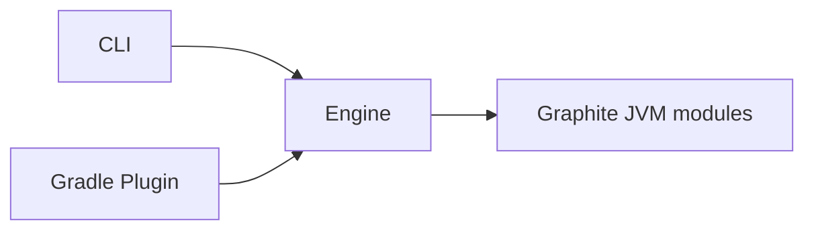
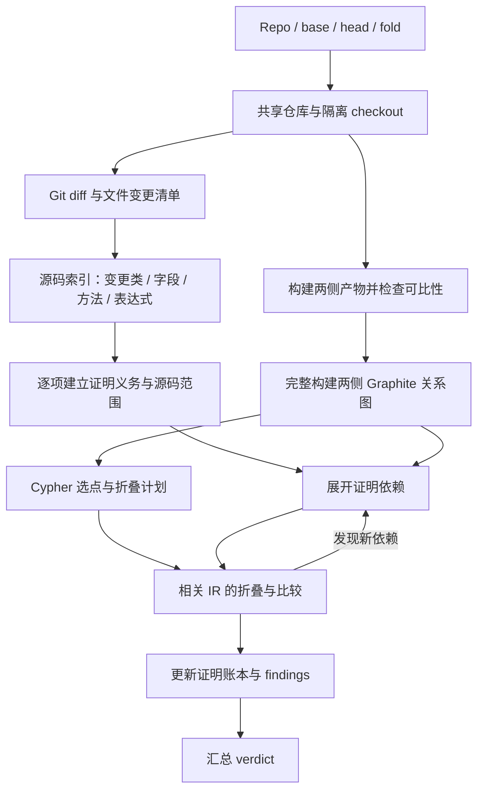

# GraphFold 设计文档

状态：设计与实现并行收敛。已实现 engine、CLI、Gradle plugin，并扩展 Java/Kotlin 检测与解释能力；扩展后的全量回归仍在验证。已执行证据见 [validation.md](validation.md)，旧版本验收不能替代新增能力的验证。本文中的目标能力不等于已经交付的保证，当前边界见第 18 节。

日期：2026-10-30。

## 1. 目标与判定契约

GraphFold 检查一次 Git 变更是否受指定的折叠条件控制。给定仓库、base commit、head commit 和折叠规则，引擎先从 diff 识别变更的类、字段、方法和表达式，为每项变化建立证明义务；再利用 Graphite 展开证明依赖，在相同假定下折叠相关 IR，检测仍然存活的 uncontrolled change，并报告精确源码位置。

**主架构：Diff 建立证明义务，Graphite 提供全局关系，折叠后的 IR 完成证明。** 不是先寻找全程序差异再筛选 diff，也不是只分析改过的方法。首版完整构建两侧分析范围内的程序图，以 diff 驱动依赖展开和深入比较；增量建图留待后续验证。

核心不依赖 AB testing。`K_PR` 表示控制本次变更的机制，`A_PR` 表示用户为它声明的基线状态假定。AB ID、feature flag、配置开关等都可以通过适配转换为折叠规则。

目标不变量：

```text
fold(head, A_PR) ≡ fold(base, A_PR)
```

`≡` 是目标语义，不是对任意程序都可自动判定的承诺。实现通过完整程度受检查的程序表示、保守折叠和明确支持的等价规则证明该不变量。不能证明时失败，不能把图相同或没有 finding 当作证明。

门禁只有两个 verdict：

| Verdict | 条件 |
| --- | --- |
| `PASS` | 分析成功完成，本次所有相关变化均被证明消除或等价 |
| `FAIL` | 确认 uncontrolled change，或存在阻止完成证明的错误、缺口或定位失败 |

`FAIL` 不等于所有失败都已证明业务行为违规。结果必须区分确定的行为差异、无法证明的变更以及运行错误。

### 1.1 变更归属

Violation 必须来自指定 base 与 head 的 diff。分析可以访问整个程序，报告不能把未修改代码算作本次新增的问题。

- 新增、修改定位到 head 的实际变更范围。
- 删除定位到 base 的实际删除范围。
- hunk 中的未修改上下文不属于变更。
- 未修改的调用者或 helper 可以作为证据，不作为 finding 的主归属位置。
- 不能仅因方法范围与 diff 相交，就认定该方法里的某项修改违规。
- 不得将无法归因的剩余差异静默丢弃；它成为阻断诊断，仍然 `FAIL`。

计算指定 `base..head` 的树差异，不自动替换成 merge-base。base 是生产版本还是目标分支由调用方决定。

### 1.2 AB 场景的映射

AB 是一个外部适配场景：PR title 中的 JIRA ticket 可以用于查询自定义字段中的一组 AB IDs，再生成规则。核心不访问 JIRA，也不从源码猜测本次 PR 的 ID。

- 单个 PR 可以声明多个 AB ID。
- A 和 NA 都属于 control。若两者产生不同执行路径，需要分别验证相关场景。
- 多个控制点应在同一场景中共同折叠，不能用分别关闭单个控制点的结果代替。
- 若有多个 control 取值，默认验证其组合；只有证明场景独立或等价后才能减少组合。超过资源预算必须失败，不能抽样后通过。
- 未声明的 ID 不参与折叠。
- NoLog 表示不发送曝光日志，但不形成额外判定规则。
- 不设置独立曝光签名、曝光差异门禁或“AB 相关日志自动豁免”。日志和其他操作一样，按其变化是否在折叠后仍存在判断。

普通变化采用上述不变量。AB clean、移除开关后的赢家收口需要不同的不变量，不纳入首版自动判定；未来应通过明确的比较模式扩展，不能隐式猜测。

## 2. 工程与职责边界

多模块 Kotlin 工程，包名前缀统一为 `io.johnsonlee.graphfold`，引擎模块使用 `io.johnsonlee.graphfold.engine`。

```text
GraphFold/
├── engine/
├── cli/
├── gradle-plugin/
└── docs/
```



| 模块 | 职责 |
| --- | --- |
| `engine` | Git/隔离 checkout、diff、构建适配、折叠编排、比较、源码归因、结果模型 |
| `cli` | 命令行解析、输入校验、报告输出、退出码；直接调用引擎 |
| `gradle-plugin` | 配置 DSL、task、Gradle 生命周期集成；直接调用引擎 |

CLI 和 Gradle plugin 不互相调用，不复制分析逻辑。引擎不依赖 Gradle API，也不在核心规则中硬编码 AB SDK。

Git 采用 JGit 与共享对象的隔离 checkout；CLI 采用 Clikt。认证集成的验证边界见第 4 节；submodule 与 Git LFS 尚未建立完整产物模型，检测到时阻断。

## 3. 输入与输出

### 3.1 请求

用户输入固定为四类：

```kotlin
data class AnalysisRequest(
    val repository: String,
    val base: String,
    val head: String,
    val fold: String,
)
```

其中 `fold` 对应用户提供的 fold Cypher。缓存目录、资源上限、构建适配器等属于引擎运行配置，不混入业务判定条件。

`fold` 当前传入 YAML 文档内容：Graphite 的 `select` 返回调用点，替换值通过独立 `value` 提供；纯查询字符串不足以表达完整假定。引擎沿用 Graphite 规则结构，并接受场景集合：

```yaml
scenarios:
  - name: baseline
    folds:
      - select: |
          MATCH (cs:CallSite {callee_class: 'example.Flags', callee_name: 'enabled'})
          RETURN cs
        args:
          0: checkout_v2
        value: false
```

这是同一个 fold 输入内部的结构，不新增第五类业务输入。单场景直接接受 `version: 1` 与 `folds`；多场景使用上述 `scenarios` 包装，每个场景均须通过。默认最多 32 个场景，超过上限阻断。YAML 必须是单一对象文档；语法错误、重复键、额外文档、未知属性、非法版本及规则结构在 Git checkout 和构建之前阻断，错误包含场景/规则索引。规则字段由 Graphite 的解析器校验，Cypher 语法和返回类型则在实际图上执行查询时校验。

规则表达的是用户授权的假定；过宽的查询也会产生过宽的假定。引擎记录实际选点供审计，并验证规则中的参数约束，但不能凭业务知识证明用户声明的假定正确。

### 3.2 结果模型

以下展示已实现模型的核心字段；完整定义以 engine 的 `AnalysisModel.kt` 为准：

```kotlin
enum class Verdict { PASS, FAIL }
enum class Revision { BASE, HEAD }
enum class FindingKind { UNCONTROLLED_CHANGE, UNVERIFIABLE_CHANGE }

data class SourceRange(val start: Int, val end: Int)

data class SourceLocation(
    val revision: Revision,
    val path: String,
    val line: SourceRange,
    val column: SourceRange,
)

data class Finding(
    val id: String,
    val kind: FindingKind,
    val ruleId: String,
    val message: String,
    val locations: List<SourceLocation>,
    val evidence: List<Evidence>,
    val scenarios: List<String>,
)

data class AnalysisResult(
    val findings: List<Finding>,
    val diagnostics: List<Diagnostic>,
    val metadata: AnalysisMetadata,
    val reasons: List<VerdictReason> = emptyList(),
    val ruleAudits: List<RuleAudit> = emptyList(),
) // schemaVersion 固定为 1；verdict 由 findings、blocking diagnostics 与证明完成情况派生，不由调用者赋值。
```

`Evidence`、`Diagnostic`、`AnalysisMetadata` 和 `VerdictReason` 已在 engine 定义。`Finding.locations` 至少一项，可跨文件和 revision，且都是本次 diff 的归属位置；调用链等未修改位置放入 evidence。纯移动的 `VerdictReason.locations` 可为空，此时以旧/新路径描述变化，不制造字符 diff。

位置约定：

- `path` 是对应 revision 中的仓库相对路径，统一 `/` 分隔。
- 行、列均从 1 开始。
- 起点包含、终点不包含，范围按 `(line.start, column.start)` 到 `(line.end, column.end)` 两个位置解释。
- `column.start` 对应起始行，`column.end` 对应结束行；多行范围不要求结束列大于起始列。
- 列单位使用 UTF-16 code unit，与 JVM 字符串及常见编辑器协议对齐；输出适配器必须显式转换其他协议的单位。tab 按字符计算，不按显示宽度展开。
- 换行、Unicode、文件结尾和跨行表达式必须有位置测试。

Finding 分类：

| 类型 | 含义 | 是否阻断 |
| --- | --- | --- |
| `UNCONTROLLED_CHANGE` | 已确认本次变化在折叠后仍存活且不等价 | 是 |
| `UNVERIFIABLE_CHANGE` | 已定位本次变化，但无法证明其受控或等价 | 是 |

构建失败、Git 失败、源码映射失败等使用阻断 diagnostic，不虚构源码位置或业务 violation。即使 findings 为空，只要有阻断 diagnostic，verdict 仍为 `FAIL`。

当前 Metadata 记录解析后的 SHA、Graphite 版本、场景和 obligation/证明完成数量。编译器版本、规则摘要、构建产物身份与完整 provenance 仍是待补的审计信息，不能声称已经输出。Finding ID 使用内容摘要，不依赖图节点编号。

JSON 报告包含 `schemaVersion: 1`，规范为 [verdict.schema.json](../engine/src/main/resources/io/johnsonlee/graphfold/engine/verdict.schema.json)，采用 JSON Schema draft 2020-12，标识为 `urn:io.johnsonlee.graphfold:verdict:1`。同一资源随 engine 打包，可通过 `AnalysisReports.schema()` 读取。Schema 校验序列化结构、必需字段、枚举、空值与数值边界，不代替引擎的语义证明。它适用于任意报告文件名；Gradle 默认仍输出 `report.json`。

## 4. 仓库获取与共享对象 checkout

大仓库采用 JGit `7.8.0.202609011348-r` 管理共享 bare object 缓存，为 base/head 创建各自独立的 checkout，不分别 clone 完整仓库。每个 checkout 有自己的 `.git`、HEAD 和 index，通过 `.git/objects/info/alternates` 引用缓存对象目录。用户原有 checkout 不受影响。

这保留了 worktree 方案希望达到的对象共享与工作目录隔离，但不是原生 linked worktree 管理。JGit 从 7.0 起支持读取 linked worktree，7.8 的公开 API 仍缺少 add/list/remove/move 管理命令；不能把“缺少管理命令”表述为完全不支持 worktree。依据：[7.0 发布说明](https://github.com/eclipse-jgit/jgit/wiki/New-and-Noteworthy-7.0)、[维护者对管理 API 的说明](https://github.com/eclipse-jgit/jgit/issues/264)。

```text
<cache>/                                            # CLI / Gradle 默认 ~/.cache/graphfold
├── git/
│   ├── repositories/
│   │   ├── <repository-key>.git/                    # bare 仓库，共享 objects
│   │   └── <repository-key>.lock                    # fetch / revision 解析锁
│   └── workspaces/<repository-key>/
│       ├── slot-0.lock                              # 进程间租约，位于 checkout 外
│       ├── slot-0/
│       │   ├── base/                               # base 构建的工作目录（cwd）
│       │   │   ├── .git/                           # 独立元数据，alternates 指向共享 objects
│       │   │   ├── .gradle/                        # Gradle 状态及 GraphFold provider
│       │   │   ├── gradlew / pom.xml / src/...      # 对应 revision 的项目文件
│       │   │   └── <module>/
│       │   │       ├── build/                      # Gradle 编译产物与 provenance
│       │   │       └── target/                     # Maven 编译产物与 provenance
│       │   └── head/                               # head 构建的 cwd，结构同 base
│       ├── slot-1.lock
│       └── slot-1/...                              # 另一对可独占的持久 checkout
└── analysis-<random>/                              # 每次分析独立的临时目录
    ├── base/                                       # 导出的 classes、origins、输入清单和构建日志
    ├── head/                                       # 同上
    └── normalized/                                 # 来源规范化后的分析输入
```

`<cache>` 指 `EngineConfiguration.cacheDirectory`；CLI 可用 `--cache-dir` 指定。上图中的 Gradle 与 Maven 目录是不同项目类型的示意，并非每个项目同时存在；根项目自身也可能有 `build/` 或 `target/`。两侧构建顺序为 base 后 head，外部 Gradle/Maven 命令的 cwd 分别是对应 checkout 根目录，多模块产物留在各模块自己的构建目录。checkout、原始编译产物和增量状态在分析结束后保留。导出到 `analysis-<random>` 的 classes 是本轮分析快照，正常完成或失败后都会尝试清理该临时目录；它不是增量编译目录。源码直接编译模式没有 Gradle/Maven 状态，classes 直接写入本轮 `analysis-<random>/{base,head}/classes`，目前不复用该模式的编译产物。

流程：

1. 规范化仓库身份，复用缓存；凭据不进入缓存键和日志。
2. 通过 JGit fetch 缺失对象：完整 SHA 优先直接获取，服务端不支持时再回退分支发现；缩写先发现分支，再解析为完整 commit SHA。歧义缩写和非 commit 对象提供明确错误，要求使用完整 commit SHA。
3. 校验两个 commit 可读取；不依赖可变 branch 名继续分析。
4. 租用空闲 slot 中的一对持久 checkout；每个仓库最多使用 `EngineConfiguration.maximumWorkspaceSlots` 个 slot（默认 2），全部忙碌时可中断地等待 `workspaceLeaseTimeout`（默认 `2 × buildTimeout + 5 分钟`，即 25 分钟），超时以 `WORKSPACE_CAPACITY_TIMEOUT` 诊断阻断分析，不产生代码变更 finding。`workspaceLeaseTimeout` 只计 commit 解析之后、checkout 之前获取空闲 slot 的等待时间，拿到 slot 即结束；不是无 activity 超时，也不限制 checkout 或 lease 持有时长。该默认值是等待预算的启发式，不是分析的总耗时上限：构建超时按外部命令生效，Maven 每个 revision 可能执行多条命令，源码模式的 javac 在进程内运行且不受该超时控制，图分析也会持有 slot。较大构建或长队列可显式加大等待预算。以原始 commit blob 恢复源码，内容及 mode 未变化的文件不重写、保留 mtime；被构建修改的 tracked 文件恢复原值，目标 commit 删除的文件移除。不运行 checkout hook 或 smudge filter。
   Slot 按同一缓存中的仓库身份共享，不绑定 PR，不缓存分析结论。对可成功获取非阻塞锁的既有 slot，优先选择完全相同的 base/head，其次选择相同 base 且 head 历史距离较近的候选；同级距离相等或无法判断时按 slot 序号确定顺序。每个 head 最多探索 256 个祖先集合内的提交（含自身），通过已观察到的共同祖先计算两侧距离之和；这是有界启发式，不承诺任意历史上的全局最近距离。已占用的 slot 跳过；没有可获取的既有 slot 时才启用空 slot。读取候选 checkout 的 HEAD 前持有其锁，选择期间最多暂持两个候选锁；时间预算耗尽但已有候选时返回该空闲 slot，不伪报容量不足。获得最终候选后仍按目标 commit 恢复源码，历史状态仅用于调度，不作为源码正确性的证据。跨 PR 的增量收益依赖实际输入差异。
5. 按目标 commit 的 ignore 规则清理非忽略的 untracked 文件。私有 checkout 的 `info/exclude` 额外保留 `.gradle/`、`build/`、`target/`，构建系统负责验证其任务输入与输出。在独立工作目录构建与分析；用 JGit 读取 commit tree 与 diff。
6. 完成分析后释放 slot 租约，保留工作目录与构建状态，后续分析继续使用相同路径。checkout 准备失败时删除该 slot 的不完整目录并释放租约；本次导出的分析快照仍独立管理。

并发与恢复：

- 影响共享仓库状态的 fetch 使用按仓库锁；等待 slot、独占 slot 的 checkout 准备和构建均不持有此锁。
- JVM 内 reservation 与操作系统 file lock 共同保证一个 slot 同时只有一个使用者；base/head 始终是独立目录。释放租约可在不同线程执行，清理不触及用户 checkout 或仍在使用的其他 slot。
- 进程退出后操作系统释放 file lock，后续分析可重新租用并恢复 tracked 源码；这不等于验证过任意崩溃点的事务恢复。JGit index 锁残留等恢复异常必须阻断，不能使用未确认的源码。持久 slot 数量受配置上限限制；历史版本或调低上限前已存在的额外 slot 不再租用，但不会自动删除。目前没有磁盘配额或自动淘汰策略；共享 objects 回收必须同时考虑所有保留的 checkout。
- submodule 和 Git LFS 尚未完整支持，检测到时阻断，不分析占位文件。
- GraphFold 的 Git 操作不使用原生命令或 CLI fallback，不要求 `git` 出现在 `PATH`。这不等于承诺 JGit 内部永远不启动进程：库的可选用户/系统配置发现行为与“Git 可执行文件必需”是不同的边界。
- HTTP/SSH 认证的实际集成尚未验证，不承诺自动沿用原生 credential helper 或 SSH agent；认证失败必须作为阻断 diagnostic 返回。

## 5. Diff 驱动的证明义务与依赖展开

Git diff 提供文件和行级变化，源码解析进一步识别声明、表达式及精确列范围。保存 base/head 双向对应，包括文件重命名与删除。

每项变更分配稳定的 change ID，后续阶段保留它与源码、声明、IR 操作之间的对应关系。



图中的阶段存在依赖而非严格串行：源码符号解析可能需要构建适配器提供 source set/classpath；应先建立文件变更清单，待解析环境齐全后完成符号绑定。未能解析的文件仍保留为未决义务，不能从清单消失。

### 5.1 变更对象与证明内容

| 变更对象 | 初始证明义务 | 可能需要展开的依赖 |
| --- | --- | --- |
| 方法体表达式或语句 | 变化在折叠后消除，或存活效果等价 | 控制条件、调用上下文、数据依赖、异常路径 |
| 方法声明 | 声明变化不留下未受控影响 | 调用者、override、注解使用、框架入口 |
| 字段 | 初始值、属性和读写语义变化受控 | 所有可能读写者、常量内联使用者、初始化路径 |
| 类声明 | 继承、接口、注解、可见性变化受控 | 实例化、动态分派、反射和框架使用 |
| 新增/删除/移动成员 | 匹配两侧身份并证明使用与生命周期影响 | 两侧调用/引用、初始化、外部入口 |
| 配置/资源/依赖/构建输入 | 对产物和运行行为的影响受控 | 生成代码、资源消费者、依赖解析及工具链 |

声明是组织分析的单位，不是最终定位的最小单位。一个方法中的多项修改保留各自 change ID 与表达式范围；相互作用的变化可组成联合证明义务，不能孤立证明后忽略组合效果。

内部证明义务至少关联：change IDs、base/head 对象身份及源码范围、适用场景、依赖集合、展开理由、完整性条件、证明状态和证据。原始 diff 必须全部归入某个义务或有依据的非语义分类。

### 5.2 双向、跨版本的依赖展开

分析从变更对象出发，在 base/head 两侧展开所需依赖，而不是仅在 head 查询引用：

1. 反向查询调用者、字段使用者及入口，判断变化是否仍可能执行或被观察。
2. 查询控制依赖和 gate，确定指定假定对到达路径的影响。
3. 前向查询调用目标、状态写入、返回值使用及异常影响，建立比较所需的行为范围。
4. 纳入初始化、动态分派、框架和生成代码等隐式依赖；没有覆盖证据的边界明确标记未知。
5. IR 分析发现新的依赖时继续加入工作队列；递归与环按稳定身份去重，不能以固定跳数截断后通过。
6. 只有证明义务已完成，或依赖范围闭合且比较完成，才结束；预算耗尽或未知边界导致未决并 FAIL。

每条展开边记录原因，便于解释为何分析未修改文件，以及为何某项缓存必须失效。最坏情况下依赖范围扩展到整个程序；diff 驱动不承诺局部修改一定只需局部分析。

### 5.3 必须覆盖的反例

**共享 helper 修改。** 从修改方法反向找调用者。如果能证明全部执行入口被折叠消除，允许通过；如果存在存活路径，比较其效果；如果存在未知框架调用，不能宣称不可达。

**字段常量修改。** `static final int LIMIT = 10` 改为 `20`，使用者的源码可能不变但字节码改变。不能仅依赖图中的字段引用，因为常量可能已内联。需要源码符号引用或编译来源信息补足依赖，检查重新编译后的使用者；无法建立完整使用范围时阻断。Finding 归属字段初始化的 diff。

**控制条件修改。** `if (gate(K)) oldHelper()` 改为 `if (!gate(K)) oldHelper()`，未修改的 helper 进入存活路径。比较必须包含其新增可达效果，finding 归属条件的 diff，不能因为 helper 不在 diff 中而忽略。

**删除与声明修改。** 只看 head 会丢失被删方法的旧调用关系；只看方法体会漏掉注解或父类修改。两侧引用与独立声明清单都属于证明输入。

不能仅依赖 Git 的 rename 相似度决定语义身份；重命名匹配是辅助信息。新增、删除、移动的方法通过完整 JVM 方法身份与源码声明映射参与比较，无法可靠配对时保守失败。

空白和注释可由源码层证明为非语义变化；涉及注解处理、代码生成或配置消费的文件不能仅按扩展名忽略。依赖、资源、构建脚本和工具链变化必须有明确处置，不能因它们不产生方法节点而漏出分析。

## 6. 构建与可比性

引擎通过构建适配器在两个 checkout 构建 pre-minification 产物，并收集项目 class、运行所需依赖、生成代码、源码目录和编译设置。

当前已有 Gradle wrapper、Maven 以及约定 source-root 的 Java/Kotlin 编译适配；支持这些入口不意味着支持全部构建布局。仓库地址无法单独确定自定义构建命令；不支持或多义的布局仍应阻断。

两侧应使用可比的 JDK、编译器及构建配置。记录仓库 wrapper、插件、依赖解析结果和其他影响产物的输入；构建成功不等于产物可比。

- 独立工作目录隔离生成文件与构建输出。
- 可以复用构建系统的依赖下载缓存，但不能复用没有输入身份校验的产物。
- 工具链或依赖发生变化时必须覆盖其影响，首版无法证明则阻断；不能静默将其归一化。
- 如使用 Gradle plugin 运行 GraphFold，内部构建不得再次触发同一个 GraphFold task，避免递归。
- 相同输入若出现无法解释的产物漂移，视为不可比，不能随机选择一次结果通过。

## 7. Graphite 能力基线

调研基线为本地 Graphite commit `5f1fd66543d617eb23a2258f3c14141383a33cc9`。以下结论是该版本的事实，不代表未来版本承诺。

| 能力 | 当前状态 | GraphFold 的处理 |
| --- | --- | --- |
| class/JAR/Boot JAR/WAR 建图 | `JavaProjectLoader` 可用 | 复用 |
| JVM Cypher 查询 | `Graph.query` 可用 | 复用 |
| 跨过程数据流 | 配置开关，默认关闭 | 选点图显式开启；不将连通关系当作确定值证明 |
| Cypher select 折叠编排 | Rust CLI 两次建图 | JVM 消费侧需实现等价的编排或抽取上游接口 |
| 折叠规则 | `ConstantFold`、`FoldSites`、`FoldPlan` | 复用规则语义 |
| 方法内常量传播和分支折叠 | 迭代到不动点 | 复用并验证边界 |
| 跨过程常量传播、wrapper 专门化 | 不是现成通用能力 | 作为独立扩展，不假定已支持 |
| 原始/折叠后 IR 成对输出 | 无完整的公共快照接口 | 优先明确最小输出接口 |
| class 扩展 SPI | 已在固定版本 2.12.0 验证折叠后 body 捕获 | 当前实现通过 ServiceLoader 接入，升级必须重跑集成测试 |
| 合成成员规范化 | internal `SyntheticIdentity` | 参考并验证后复用，不当作通用等价证明 |
| 精确源码位置 | 调用点多处行号为 null，无完整列范围 | GraphFold 补源码映射 |
| 建图完整性 | 存在跳过方法/控制流的降级路径 | 补结构化阻断诊断 |

### 7.1 已验证的范围

调研期间运行了以下六个测试类，共 98 个测试，全部通过：

- `ConstantFoldTest`：16。
- `ConstantFoldEdgeCaseTest`：14。
- `FoldSelectionTest`：16。
- `EnumEqualsFoldTest`：4。
- `ConstantEqualsFoldTest`：10。
- `JavaProjectLoaderTest`：38。

这些测试验证了现有功能的特定行为，不是 GraphFold 的端到端验收，也不是性能证据。后续 GraphFold 集成测试已验证 SPI 捕获、Java 源码列映射与规范化 IR 比较；真实业务仓库及一般语义等价仍未验证。

### 7.2 不能直接继承的保证

- 关系图不完整保留算术、数组索引和语句级控制流，图哈希相等不足以通过。
- `--fold-strict` 只处理 unmatched，不能替代对 unsupported 的检查。
- adapter 可能在方法级 OOM/解析问题后继续建图；超过 2,000 条语句的方法会跳过关系图控制流提取。必须将这些情况结构化报告。
- `bodyInterceptionFallbackCount` 是 APK 专用计数，不代表 Java 分析完整性。
- 调用点 ordinal 是同 caller 内同 callee 的调用排名，不是完整执行顺序。
- 方法身份使用包含返回类型的 `identity`，不能仅用 `signature`。
- 声明了 `buildCallGraph` 或分析算法枚举不代表有完整可达性证明；当前附加 call graph 结果并不直接补入图，部分算法配置回退到 CHA。

## 8. 选点与折叠流水线

此阶段为第 5 节的证明义务提供折叠证据。首版完整构建两侧关系图，不依据 diff 裁剪建图输入，也不先假定未知依赖与变更无关。每个 revision 独立执行：

1. 构建未折叠图，保留分析完整性信息。
2. 在该图运行每条 select，要求结果符合调用点 schema。
3. 解析稳定调用点 key：caller/callee 的完整描述符及 ordinal；不得跨 revision 复用局部节点 ID。
4. 保留派生 lambda 调用的 origin，并检查选中范围是否覆盖同一实际调用可能运行的目标；不能把部分目标选择扩大成全部目标折叠。
5. 校验 `args`、`receiver_args` 和 provenance，形成该 revision 的 resolved plan。
6. 通过同一前端重新物化方法体并执行折叠，输出折叠后 IR、变换记录和完整性状态。首版可以保持现有完整第二次构建；深入比较由证明义务及其依赖选择，不假定现有 loader 已支持按需局部折叠。

原始选点图可以在多个假定场景间复用，前提是查询选择不依赖折叠后的结果且所有输入身份一致。base/head 各自选点，不能强求调用数量相等。

每个场景的每条规则若在 base 和 head 两侧都没有实际匹配调用，会产生阻断 `UNMATCHED_RULE`。新引入的控制点只在 head 匹配、已删除的控制点只在 base 匹配可以合法；不要求两侧数量相等。查询失败、返回类型不符和无法验证的折叠另行阻断。没有 diff 时不必执行建图和选点，不将这一跳过路径误报为零匹配。

每个场景 × revision × 规则索引（从零开始）都有 `ruleAudits` 记录：

- `selector` 保存类型、原始 Cypher（非 Cypher 规则为 null）与描述。
- `selectionStatus` 为 `NOT_EXECUTED`、`SELECTED` 或 `FAILED`；`message` 解释跳过或失败。
- `selectedNodes` 保存原始未折叠图的唯一调用点：节点 ID、caller/callee 签名和 JVM 描述符、可空 ordinal、originNodeId 与调试行号。实际查询只执行一次，审计在来源归一化及派生调用转换之前捕获。后续规则或折叠失败不会抹去已获得的记录。
- `selectedCount` 在 `SELECTED` 时为节点清单长度（可为 0），其余状态为 null。`matchedCallCount` 独立记录 Graphite FoldReport 的实际匹配调用数，尚未产生结果时为 null；参数约束或派生调用可能使它与选点数量不同，它也不代表所有折叠已成功完成。

节点 ID 仅在对应场景/revision 的图内有意义，不能跨版本 join，也不替代 finding 的精确 diff 坐标。非 Cypher 的 `CALL_SITE_MATCH` 规则同样记录原始图上的候选调用点；为此无来源归一化路径也需要物化未折叠图，尚未完成代表性多图负载性能验收。

CLI 将每条完整审计记录以 `[graphfold.fold]` 加紧凑 JSON 写入 stderr，保留 stdout 的单一 JSON 报告；Gradle 使用默认可见的 lifecycle 日志。文本报告也包含同样记录，节点清单不截断。

### 8.1 折叠语义

折叠调用按规则替换成指定常量，传播常量，解析分支并移除不可达语句。规则必须明确是整个调用的替换假定，不能暗中仅假定返回值，却又消除它的所有行为。

调用前的参数求值、接收者求值和 wrapper 中的其他操作不因返回值固定而自动删除。额外删除必须证明其无可观察效果，包括异常、终止性、类初始化及同步语义。

例如：

```java
boolean eligible = checkEligibility(user);
if (eligible && gate(key)) {
    newBehavior();
}
```

`gate=false` 允许删除 `newBehavior()`，不能据此删除 `checkEligibility(user)`。新增 precondition 若留在存活路径中，就应参与比较。

不采用“无副作用且没有新增解引用就一定安全”的宽泛规则：整数除零、数组越界、类型转换等同样可能改变行为。

### 8.2 跨过程边界

图查询可以发现经过 wrapper 的调用点，但数据流存在路径不意味着实参唯一，也不意味着传播保持值不变。

```java
enabled(PR_K);
enabled(OTHER_K);
```

默认不得将共享 wrapper 内的 SDK 调用整体替换并声称只影响 `PR_K`。使用能够在实际调用点证明的参数约束；无法证明则保留并阻断相应变更的放行。

后续可实现按调用上下文的参数传播、方法摘要和分析用专门化；这些能力不在首版可用能力中预支。用户若显式写出无条件替换整个调用点的规则，结果的保证范围也只能相对于该假定成立。

## 9. 比较表示与算法

关系图用于查询和关联，完整方法 IR 用于比较。优先复用现有 Jimple 前端，避免另建一套字节码解析器。

### 9.1 方法快照

建议输出独立、不可变、可逐方法消费的快照，包含：

- 完整方法身份、声明属性及相关注解。
- 有类型的操作、操作符、有序操作数、常量精确值。
- 调用种类、接收者、目标及实参。
- 字段与数组读写及地址/索引。
- 普通与异常 successor、分支目标、return、throw、monitor。
- 原始指令身份、源码映射线索、折叠前后关联；这是需要增加的 provenance 能力，不假定现有 Jimple statement 与字节码指令天然一一对应。
- 成功、跳过、降级、失败状态。

不能保存全库可变 `BodyBuilder` 或全库 SootUp body。方法快照可落盘或立即摘要，原始转换状态按前端生命周期释放。

方法之外必须另有 class/field 声明清单：继承与接口关系、类与成员可见性、static/final/volatile 等属性、字段 ConstantValue、注解及泛型 metadata，以及初始化方法。只有方法快照不能覆盖纯声明变更；这些属性是否影响特定程序的行为需要对应规则，不得直接忽略。

推荐的上游扩展位置是：折叠 mutation 前、全部 cleanup 后、未触及方法的处理位置。当前固定版本的 class SPI 已通过正确性原型验证，可捕获 cleanup 后的 IR；折叠前后 provenance 和稳定的上游快照契约仍是缺口。

### 9.2 分层比较

1. **输入身份复用**：完全相同且上下文适用的产物/方法可复用已验证快照。
2. **规范化结构比较**：局部变量编号、块标签、调试行号等非语义信息不进入行为身份；保留操作及执行顺序。
3. **义务驱动的折叠后比较**：比较变更对象及证明依赖中的存活行为、声明与路径，结合可达性处理被消除的 helper；包含必要的未修改方法，不默认扫描全图差异作为 finding 来源。
4. **局部等价证明（后续）**：仅对明确支持的表达式或区域运行符号推理，遵守 JVM 溢出、浮点和异常语义；超时不通过。

哈希是比较加速器，不代替表示覆盖检查。不得通过排序所有调用、忽略异常边或去掉字段属性来降低误报。仅对有语义依据的变换做规范化。

规范化 IR 或哈希不同只表示结构比较未能证明等价，不自动构成语义不等价证明。只有受支持的差异判据或可验证反例确立可观察差异时，才归类 `UNCONTROLLED_CHANGE`；其他未能证明等价的差异归类 `UNVERIFIABLE_CHANGE`，同样阻断。

SSA、内存依赖和别名分析是提高精度的候选手段，不是声称现有 Graphite 已提供的能力。未支持的变化必须进入 `UNVERIFIABLE_CHANGE` 或阻断诊断。

局部比较成立还需要证明所选范围足以覆盖本次变化的影响。某个方法折叠后一致，不能单独解除同一声明变化对其他使用者的义务。多个义务共享比较结果时，必须携带该结果的假定、上下文及完整性前提。

### 9.3 可达性与方法增删

方法体等价与方法是否可执行是两个维度。

- 已修改方法若在折叠后仍可能执行，比较其存活行为。
- 若能证明仅从被折叠路径可达，允许其变化被消除。
- 新增方法不能因为没有调用点就通过；删除方法也不能仅因缺少图节点就被忽略。
- Java backend 的框架入口包括 controller、listener、scheduled job 等；反射、动态加载和框架代理需要明确边界。
- “全部已知调用点已死”不等于“无任何入口可达”。未建立完整性条件时保留方法，不做死方法推断。

首版允许更保守的误报，但不能以不完整调用图放行。后续框架适配只能扩展可证明范围。

## 10. 源码映射与 findings 生成

精确范围需要源码层与字节码/IR 层共同工作，不能仅凭字节码 LineNumberTable 推导列号。源码定位采用 JavaParser 与 headless Kotlin PSI，和 Graphite/Jimple 承担不同职责。

1. 从 diff 和源码索引建立 change ID、声明及表达式的准确范围，作为证明义务的起点。
2. 使用类/方法 descriptor、调试信息、生成代码来源等，将义务绑定到两侧 IR；字段与类声明另行绑定声明清单。
3. 依赖展开时保留未修改对象与原始义务之间的关系，在折叠与规范化过程中传播来源信息。
4. 将义务中的存活差异关联回其初始变更范围；虽然起点已有范围，仍需证明具体哪项变化导致差异，不能自动把整个义务中的所有修改都标错。
5. 对涉及多个表达式或文件的同一原因合并 evidence，保留全部已确认主归属范围；未知因果关系保留未决，不猜测。
6. 确保每个主位置在相应 revision 中存在，确实来自 diff；未修改依赖只作 evidence。

Java 源码定位为首版重点。其他 JVM 语言、注解生成代码、无源码依赖的定位支持需明确声明；映射失败时不输出猜测范围。

对于外部依赖变更，只有能建立可靠来源关系时才将 finding 归因到依赖声明的 diff；否则用全局阻断诊断说明不能完成证明。

### 10.1 JavaParser / Kotlin PSI 的角色

当前通过 `JavaSourceIndex` 与 `KotlinSourceIndex` 提供统一的 `IndexedSource`/`SourceSymbol` 输出：Java 使用 JavaParser，Kotlin 使用 headless Kotlin PSI。源码适配属于 engine 内部能力，不新增交付模块。2026-10-31 决定不采用 UAST，相关实验仅保留为历史调研，不作为后续迁移计划。

```text
源码 → JavaParser / Kotlin PSI → 声明与表达式索引、文本范围
                       ↕ 来源映射
字节码 → Jimple IR → 折叠前后操作 → 存活差异
                       ↕
                 Git 变更清单
```

源码适配器负责声明、表达式及物理文本范围；Graphite/Jimple 负责字节码行为分析。源码语法视图不作为行为等价判据。位置来自原始文件范围，不从合成声明或字节码行表猜测列号。UAST 的历史运行时和定位评估见 [调研记录](uast-integration-evaluation.md)。

现有源码适配器仍须结合实际编译产物，持续建设和验证以下来源关联：

- 完整 JVM descriptor 与源码声明的匹配，包括泛型擦除、bridge、构造器及嵌套类。
- 同一行多个调用或表达式的区分，不能仅靠行号和调用目标配对。
- lambda、Kotlin 默认参数、属性访问器、inline、suspend 及编译器生成成员的一对多映射。
- Kotlin 的调试扩展信息与源码位置关联；有映射信息也不代表一定有精确列号。
- 注解处理器及其他生成器的来源映射；无可验证生成来源时保留阻断状态。
- 构建 source set、classpath、语言版本、编码与源码解析环境的一致性。

来源关系必须允许多对多：一个表达式可产生多条 IR，一个规范化结果也可能合并多个来源。不能用最近的 AST 节点、相同行号或第一个候选补齐位置；存在歧义且无法可靠归因时阻断。

### 10.2 源码定位方案的取舍

| 方案 | 获益 | 代价或边界 | 当前选择 |
| --- | --- | --- | --- |
| UAST + Java/Kotlin PSI | 统一两种语言的源码访问，获得物理源码范围 | 需组装和验证 headless 环境、版本组合及解析依赖；仍需 IR 来源映射 | 不采用，保留历史调研 |
| JavaParser + Kotlin PSI | 直接获得两种语言的物理源码范围，分别解析声明与表达式 | 两套适配器需要一致的坐标与身份契约；生成成员仍需字节码对应 | 当前采用，Kotlin compiler/PSI 固定 2.1.20 |
| 仅字节码行号 + diff | 接入简单 | 无法可靠定位列或同一行多个表达式 | 不满足输出契约，不作为正式方案 |
| 编译阶段额外来源记录 | 从真实生成类取得匿名对象来源，不依赖生成名称和行表 | 接入构建并限制编译器版本；不等于逐条 IR 来源 | 匿名类采用编译插件 sidecar，其他生成成员保留现有适配 |

headless Kotlin PSI 已通过实际编译及定位测试，使用只读 token 遍历，避免依赖 IDE 的 PSI copy/replace 扩展点。headless UAST 的隔离整合验证见 [评估报告](uast-integration-evaluation.md)，已决定不采用，实验不作为待完成的迁移任务。Kotlin 方法使用 PSI 声明范围、ASM 方法名和行表匹配实际 JVM descriptor，字段使用真实字节码清单；不猜测 suspend/default/extension 的生成签名。歧义声明回退至对应 owner 的 CLASS obligation，缺失 SourceFile 或 owner 会阻断；回退扩大了比较范围，可能增加误报。精确报告位置仍来自文本 diff 与源码范围，不来自行表推算列号。

按变更文件及证明所需依赖延迟加载源码索引，不为所有依赖展开完整源码 AST。PSI 的文本和范围访问可能触发 AST 加载，必须控制生命周期；这是架构上的资源约束，不是尚未测量的性能承诺。参见 [PSI Performance](https://plugins.jetbrains.com/docs/intellij/psi-performance.html)。

### 10.3 未解析名字与编译器生成符号

名字解析和来源定位是两个不同问题。每个 revision 内，普通方法通过 JVM owner、name、descriptor 识别；源码片段则通过 revision、仓库相对路径和物理文本范围识别。二者之间需要允许多对多关系，不能把源码短名字作为通用 join key。

| 情况 | 当前处理及限制 | 更精确的来源关联需要什么 |
| --- | --- | --- |
| Java 声明解析失败 | 记录 `SOURCE_RESOLUTION_FAILED`，即使存在外层 class obligation 也不静默忽略诊断 | 完整的模块 classpath、生成源码和实际编译签名 |
| Kotlin 声明无法唯一匹配 | 已知 emitted owner 时保留 CLASS obligation；缺少 owner/SourceFile 时阻断 | 模块身份、Kotlin metadata、编译来源记录；不能只按同名文件配对 |
| lambda / 匿名 callback | 比较真实生成实现和调用依赖；方法义务也保守纳入同 owner 的 synthetic 方法和嵌套类 | invokedynamic bootstrap implementation handle、EnclosingMethod/InnerClasses 与物理 lambda 范围的关联 |
| bridge / 默认参数 / accessor | 不因 generated 或 SYNTHETIC 而跳过；保留生成方法及其可达行为 | 将转发方法、默认值表达式及 accessor 分别绑定到原声明；一个声明可对应多个 JVM 成员 |
| suspend / inline | 在实际生成的字节码上分析；部分源码变更仍通过类级义务覆盖 | 状态机与原函数、inline 展开与调用点的来源关系；调试行号不能提供可靠列号 |

`lambda$…$0`、匿名类序号和状态机名称不是跨 revision 的稳定身份。匿名对象已采用下节的编译来源与源码上下文配对；lambda 实现方法、状态机等其他生成符号尚无通用跨编译器等价模型。其编号或 lowering 差异仍可能留下结构差异，不能承诺自动识别为重构。无法消歧时保留未决状态。

精确 diff 坐标不等于精确行为归因。生成符号定位 fixture 同时检查实际字节码结构和 finding 的 base/head 行列，但单变更 fixture 不能证明多处变化时哪个表达式单独导致差异。扩大到方法或类的义务可以保守阻断，不能把它描述成已建立每条 IR 到 AST 的精确映射。无法确认归属时使用 blocking diagnostic；不得伪造某个邻近源码位置。

### 10.4 匿名类与图的稳定关联

同一 revision 内的定位与跨 revision 的配对是两个步骤。`Outer$1` 是该次编译的真实 binary owner，可以连接字节码和图；它不是跨版本稳定身份。GraphNodeId 也只在当前图内有效。

```text
物理源码表达式（仓库相对路径、UTF16 范围、源码 SHA-256）
  ← javac Trees/Elements 或 Kotlin JVM ClassGeneratorExtension
  → 实际生成 owner（包括 inline 复制）
  → AST 上下文配对 → 两侧比较身份
  → typed 字节码/metadata 归一化 → Graphite 折叠与比较
```

**编译记录。** javac 在 attribution 后读取 `Elements.getBinaryName`，并用生成事件确认输出；Kotlin 插件从实际 JVM class generation 读取 emitted owner 与 IR 源码范围。inline 复制通过 provenance 身份绑定的临时不可见 annotation 传播定义来源。编译完成后写入 sidecar；直接编译、Gradle 和 Maven 适配器都接入该插件。Gradle 保留项目的增量编译与 build cache 配置，不设置 `incremental=false`、强制执行或禁止缓存。编译插件的内容摘要作为稳定 provenance 身份，插件路径位于 checkout 的 `.gradle/graphfold/`；每个编译 task 在自己的 `build/graphfold/origins/<task>/` 中保存声明的输出。增量编译产生的 owner 覆盖旧记录，未重编译的 owner 必须同时通过源码 hash 与 class hash 校验；已删除 class 的记录被移除。编译成功后再发布完整 manifest；失败或缺失的记录不能通过旧 manifest 放行。`UP-TO-DATE` 和 `FROM-CACHE` 的 classes 与 provenance 一起接受校验，再导出到本次分析的独立目录。Maven 使用临时配置覆盖并在 finally 恢复 POM。

Kotlin inline 副本还依赖定义的物理源码身份：只在定义前增加空行时，KGP 可能认为 inline 语义未变，不重编译调用方，但旧副本的来源 hash／offset 已过期。因此为每个 Kotlin 编译 task 增加 `inlineSources` 插件参数，覆盖本 task，以及逐层遍历各项目自身 compile classpath 得到的项目依赖闭包中的 inline 来源文件；这包括调用方 classpath 不直接暴露的 `implementation` 依赖。这些文件的路径／内容摘要变化时，由 Gradle/KGP 的正常输入失效机制重编译受影响的 task；其它普通源码编辑保持增量编译，无关项目继续 UP-TO-DATE。识别采用保守的 `inline` token 筛选、文件粒度 hash，包含该 token 的注释／字符串或同文件其它声明的编辑也可能多触发一次受影响 task 的重编译；不会靠猜测偏移修补旧来源记录。

当前 Gradle compiler arguments 含 checkout 内的绝对路径，build cache 按 checkout 路径隔离；支持同一路径的增量、up-to-date 与缓存恢复，不承诺跨目录或跨机器缓存命中。Kotlin marker 中仍保存物理源码路径，不能直接把其它 checkout 的 sidecar 当作本地来源。编译输出正确性与大仓库性能是不同的验收项目；后者仍需代表性的多图负载测量。

Maven 同样保留项目配置的增量编译；配置未变且上次构建完整时，不强制 `useIncrementalCompilation=false` 或执行 `clean`。checkout 的 `target/graphfold/maven/` 保存稳定 provider、来源快照与编译器输出清单。javac 的 GENERATE 事件以及 Kotlin 实际输出消息记录 class 的 owner 与物理输入文件，独立于匿名对象的源码范围；不能从 `SourceFile` 或生成类名反推删除归属。增量结果合并后校验源码与 class hash，删除源码或重编译后消失的 owner 只清理先前编译器明确记录且 hash 未变化的输出；Kotlin 对应的增量 class 缓存也必须核对。未归属的 class、混合来源的部分删除、来源或字节码过期均阻断。Maven 的 effective POM／provider 身份改变、首次接管未验证的输出或上次构建未完成时，自动删除当前 reactor 各模块的 `target/` 并重新构建，成功后恢复增量复用；不会因旧身份永久阻塞持久化 slot。reactor 由 effective POM 的已激活模块声明递归解析，不扫描 fixture/example POM；生产源码只从这些模块的约定根目录导出，source-only 模式也只编译仓库根目录的约定源码。保留 `-DskipTests` 并编译测试源码，以支持 reactor 的 test-jar 依赖；测试 class 不导入分析结果；测试编译 execution 使用独立 `test-origins/`，避免相同 FQCN／匿名 owner 覆盖生产来源。混合 compile 与 test-compile goal 的单一 execution 明确阻断。Kotlin Maven 2.1.20 的跨文件 inline 物理位置变化已验证由原生增量编译刷新副本的 hash 与 offset；没有照搬 Gradle 的参数失效策略，其它编译器／依赖组合仍需单独验证，未刷新的副本由 hash 校验阻断。

**校验。** 引擎检查成功构建的 runId、schema、完成标记、源码 hash、文件归属、范围、实际 class 和 Kotlin marker，并将编译范围与 AST 表达式精确匹配。找不到、重复或过期的记录产生 `UNVERIFIED_ORIGIN`，不能变成 PASS。Kotlin 编译器会折叠 CRLF 并去掉开头 BOM，provider 先将 IR 偏移转换回原始 UTF16 边界；inline marker 中的物理坐标不再转换。headless PSI 使用保持文本长度的输入预处理，token 与报告坐标仍取原文。sidecar 范围使用从零开始、末端不包含的 UTF16 offset；报告仍保留 diff 的文件与一基起止行列。来源绑定不依赖 SourceFile/LineNumberTable；普通 Kotlin 方法的现有索引仍有自己的调试信息限制。

**跨版本配对。** 文件对应关系（包括 Git rename）、命名声明、匿名父表达式和 AST 上下文共同约束候选。唯一上下文可以绑定内容发生改变的对象；在同一命名作用域内，唯一的未变表达式可辅助识别上下文移动。结构相同不是单独的身份依据。重复同形表达式无法区分时阻断，不按出现顺序配对。一个定义被 inline 成多个类时，定义范围本身不够；仅当真实字节码的分配调用方上下文可唯一地区分副本才配对。同一调用方法内的多个不可区分副本仍阻断，不能把多个 emitted owner 合并成一个类。实际 `InnerClasses`/`EnclosingMethod` 关系用于嵌套依赖，不再以 `$` 名称前缀推断。匿名类 body 内的改动可以建立类义务；allocation 的构造参数可能在调用方执行（Java fixture 已验证），不能因整个表达式绑定到类而遗漏参数变化。参数区保留外层义务及其构造调用依赖；Kotlin 的实际 lowering 可能将表达式放进生成构造器，不能照搬 Java 的字节码假设。

**归一化边界。** 仅在隔离的分析产物中通过 ASM typed remapping 改写 owner、descriptor、类型和引用，并通过 Kotlin metadata 的结构化读写改写类型身份。临时 annotation 被移除，用户字符串常量及普通 annotation 字符串保持原值。保留声明自身的访问标志、enclosing method 和代码；外层类型的匿名类索引项不作为执行行为差异。Cypher 在原始编译身份的图上求值，然后将选中的实际调用 key 映射至比较身份，不能让内部比较名称改变用户的选点范围。

默认 `Object.toString()`、对象字符串化、序列化及显式栈捕获（Throwable、Thread、StackWalker）等操作可能观察到真实类名；存在相关路径时不能把重编号当作等价。守卫同时检查直接调用和 invokedynamic 中的方法引用；通过实际继承关系识别 Throwable 构造，包含返回给外部调用方、稍后读取栈的异常对象，未知继承关系也会阻断。对象字符串化现在使用方法内 ASM 数据流分析：跟踪具体分配、局部变量别名、栈、强制转换和分支合流；只有所有可能值均可证明安全时才收窄守卫。未改名且没有自定义 `toString`/`hashCode` 或接口行为的具体分配、最终标量类型，以及支持 null 的静态转换调用中的 null 可以通过。实例接收者还必须可证明非 null，避免忽略异常栈中的 owner；类型声明不是具体分配，cast 不会把未知引用变成已知。绑定方法引用须有已知 bootstrap、唯一实例目标和安全接收者；字符串拼接还检查 bootstrap 常量。字段读取、一般跨方法返回值、引用数组及集合元素保持未知。可变字符串构造器、格式化及控制台输出保留守卫：局部对象身份不能证明其堆状态、参数前提及虚调用覆盖行为。分析失败或不可达指令缺少 frame 时保持阻断。栈捕获不取决于被打印对象，序列化也有独立合同，因此这两类守卫继续保守执行；尚未实现跨过程 points-to 或通用堆/容器模型，仍可能过度阻断。既有反射、动态加载和外部对象逃逸限制也继续生效。此处证明的是受声明模型约束的程序表示等价，不是任意 JVM 可观察行为的完全等价。

**Kotlin 兼容性必须分层声明。** 相同 provider binary 已实测 1.9.20/K1、2.0.21/K2、2.1.20/K2、2.2.10/K2，以及 2.1.20 使用 language 1.9/K1；覆盖同一行多个 object、嵌套、初始化器、companion、inline 复制与 suspend callback。每个组合都验证 LF、CRLF、CR、BOM+CRLF 四种输入，共 20 次成功编译，每次产生 15 条已核对的物理来源记录且无 unresolved；未支持版本（测试 1.9.0）明确拒绝。可复现脚本与日志见 [编译器验证](experiments/kotlin-origin/README.md)。这只证明来源捕获，不证明不同编译器的 lowering 产物行为等价。当前 metadata 归一化最高验证至 2.1 schema；2.2 来源捕获成功不代表 2.2 的完整检测已支持。contracts、type aliases、类型 annotation 的额外 metadata 模型尚未实现，遇到时明确阻断。

验收同时覆盖正例与反例：新增 32 组 Java/Kotlin 配对 fixture，包含重编号、同一行多个对象、重复对象、嵌套、字段/实例/静态初始化、super 构造参数、受 gate 控制和未调用代码；另有真实编译的缺失调试信息、损坏 sidecar、inline 副本及原始 Cypher 选点测试。22 组历史生成符号定位 fixture 仍保留。最新全量测试与各模块 95% 分支硬门禁状态以 [validation.md](validation.md) 为准，不能以单独的编译器探针替代全链路验收。

## 11. 完整性与 verdict 汇总

从 diff 初始化证明义务账本，再为每个义务及适用场景记录下列状态。只有覆盖全部 diff 的分类完整、证明所需依赖完整、各场景均完成，账本才可关闭：

| 状态 | 结论 |
| --- | --- |
| 非语义变化 | 源码/构建语义已证明不影响行为 |
| 已消除 | 指定假定下不可达或被合法折叠 |
| 等价 | 存活表示完整且已证明一致 |
| 不等价 | 生成 `UNCONTROLLED_CHANGE` |
| 未决 | 生成 `UNVERIFIABLE_CHANGE` 或阻断 diagnostic |

仅在所有相关变化及联合义务属于前三类，且构建、选点、分析和定位无阻断问题时 `PASS`。工作队列为空不等于证明成功：未知引用、未解析变更、未展开依赖和未完成场景都必须显式保留为未决状态。

以下情况不得静默降级：缺类、方法解析失败、超过分析预算、未覆盖的语义、规则应用不完整、产物不可比、来源映射失败。诊断需要给出阶段、方法/文件（若已知）、原因及可操作建议。

缺口是否影响结论本身需要依据。首版可以保守阻断整个分析；后续只有证明与本次变化和证明依赖无关，才能将其降为非阻断信息。

## 12. CLI 与 Gradle plugin

### 12.1 CLI

当前 CLI 形式：

```sh
graphfold --repository <url> --base <sha> --head <sha> --fold <rules.yml> --format json
```

采用 cmdline library 负责帮助、参数校验与错误提示。stdout 用于报告，stderr 用于进度和运行日志，便于 CI 消费结构化结果。

当前退出码：`0` 表示 `PASS`，`1` 表示分析门禁 `FAIL`，`2` 表示输入、Git 或构建失败，`3` 表示可重试的工作区容量等待超时。所有非零状态均不放行；运行失败能够生成结果时，结果 verdict 也是 `FAIL`。

`graphfold --version` 无需分析参数，输出构建时打包的版本号后以 `0` 退出。release 构建通过 `-Pversion` 指定版本；非 release 构建使用 `gradle.properties` 中的 `baseVersion`（当前 `0.1.0`）加 JGit 读取的 HEAD 前 12 位 SHA，例如 `0.1.0-a1b2c3d4e5f6`。基础版本由配置管理，不自动查找 tag。各模块、发布产物和 CLI 共用同一个版本值。显式指定版本会跳过版本推导中的 Git 读取；现有发布插件自身仍要求 Git 元数据，因此不能承诺源码归档直接构建。运行已打包的 CLI 不需要 Git。release 校验同时验证 CLI JAR 内的版本资源与 ZIP/TAR 内可执行文件的版本输出。

### 12.2 Gradle plugin

当前 plugin ID 为 `io.johnsonlee.graphfold`，task 名为 `graphFoldCheck`。通过 Gradle Provider API 读取 `graphfold.base`、`graphfold.head` 和 `graphfold.fold` 三个必需的 project property；仓库默认使用 root project 目录，规则文件的相对路径也以该目录解析。不注册 `graphfold` extension。输出机器可读和人类可读报告；门禁失败时 task 失败。

执行参数同时提供 CLI 和 Gradle property 入口：`--workspace-slots` / `graphfold.workspaceSlots`（默认 2），`--build-timeout` / `graphfold.buildTimeout`（每条外部构建命令默认 600 秒），`--lease-timeout` / `graphfold.leaseTimeout`（默认两次构建预算加 300 秒）。显式数值范围为 `1..2147483647`；超时单位为秒。未覆盖 lease 时，增大 build timeout 会同步增大默认等待预算。CLI 的 `--build-env NAME` 可重复，Gradle 的 `graphfold.buildEnv` 用逗号分隔变量名；两者均向默认 allowlist 增补名称，从启动进程继承对应值，不接受 `NAME=value`。SDK 仍可直接设置 `EngineConfiguration`。

CLI 对工作区容量超时返回 exit code `3`，供 CI 选择重试；其他输入、Git、构建失败仍为 `2`，分析 gate 失败为 `1`，通过为 `0`。Gradle worker 保留诊断报告，并以容量超时专用消息使 task 失败。所有失败均阻断 gate，入口不自动重试。


当前使用 process-isolated Worker API 隔离分析依赖与内存，worker 直接调用引擎，不通过 CLI 转发。

分析 task 默认不宣称可缓存：远程仓库状态、外部构建和工具版本必须先转成完整且可复现的输入身份。当前显式调用 `graphFoldCheck`，不自动挂到 `check`，避免内部构建递归。

## 13. 大仓库的资源与缓存策略

- Git objects、依赖下载缓存共享；每个仓库复用持久 slot，base/head 与并发分析的 checkout 和构建输出隔离。slot 保留增量状态，不做无条件全目录清理；尚无磁盘配额或自动淘汰。
- 原始选点图按输入身份复用，场景折叠结果分别标识。
- 首版完整建图，diff 驱动深入比较；不实现仅重建变更类的增量建图。收益首先来自减少不必要的比较与源码展开，不预支建图成本下降。
- 方法 IR 流式消费与落盘，不能因做比较而重新长期驻留整个程序。
- base/head 构建或场景并发受总内存预算控制，不固定假设并发越多越快。
- 同一 loader 实例不并发执行多次 load；每个工作单元使用隔离实例。
- 支持取消，取消传播到构建与分析进程，并完成受控清理。
- 缓存键包含 commit/产物摘要、构建设置、依赖、Graphite/GraphFold 版本、规则与场景、表示 schema 版本。不能仅按方法名或 Git SHA 缓存等价结论。
- 证明结果的复用还须校验依赖集合及前提：调用者、使用者、类型层次、入口或假定变化都可能使未修改方法的旧结论失效。增量建图和跨 revision 证明缓存后续单独验收。

本设计不作性能承诺。性能回归验收必须使用代表性的真实多图负载，测量请求实际覆盖多张图；单图和合成输入只用于正确性检查，不作为性能诊断或验收证据。

## 14. 验证计划

优先验证从真实 Java 源码到 verdict 和位置的完整链路，SPI 验证不在优先路径。

### 14.1 成对程序语料

每类修改至少覆盖两个方向：位于可消除路径时通过，位于存活路径时失败。

| 类别 | 必须覆盖 |
| --- | --- |
| 运算 | 加减替换、操作数交换、字面量、溢出、浮点特殊值 |
| 内存 | 字段写入顺序、数组索引、别名、volatile |
| 控制流 | 反向 gate、条件扩大、else 修改、early return、循环、switch |
| 异常 | 新增 throw、catch 类型、finally、除零、越界、错误 cast |
| 调用 | 目标替换、参数顺序、调用顺序、重载、bridge、lambda |
| 控制点 | 多 ID、A/NA、多场景、共享 wrapper、receiver key、字段传播 |
| 前置条件 | 保留求值、副作用和异常，不能随 gate 一起抹掉 |
| 可达性 | treatment helper、共享 helper、框架入口、新增/删除方法 |
| 声明及资源 | 注解、修饰符、初始化、配置、依赖变化 |
| 非语义变化 | 空白、注释、行位移、局部变量和合成成员编号漂移 |
| 定位 | 多行、Unicode、删除、重命名、同一行多个表达式 |
| Diff 驱动依赖 | 修改 helper 但 caller 不变、内联常量改变未修改使用者、条件改变未修改代码可达性、仅 base 存在的删除引用、互相作用的多项修改 |

### 14.2 故障与集成验证

- 模拟缺类、解析失败、unsupported、选点错误、OOM/预算耗尽、定位失败，断言不能 `PASS`。
- 对比 CLI 与 Gradle task 的 findings、verdict 和稳定 ID。
- 验证 checkout 并发、取消、崩溃恢复与缓存失效，不修改用户 checkout。
- 验证所有 finding 主位置确实归属于 diff，且列范围对应正确源码。
- 验证每个 diff 项都进入义务账本，依赖队列遗漏、未知边界、预算耗尽和未完成场景不能关闭义务。
- 对具备独立预期的成对语料，将 diff 驱动分析与完整范围分析交叉检查，发现依赖展开遗漏；两者共享 IR 时结果一致不能单独证明正确。
- 验证修改未变化方法的调用上下文、入口、常量和类型层次会使相关证明缓存失效。
- 反事实运行测试作为第二道验证，用 base 测试检查折叠假定下的 head；不替代静态判据。

## 15. 落地顺序与待决事项

### 15.1 实施顺序

1. 固定输入规则编码、位置契约、首版构建与源码语言范围，建立 diff → 类/字段/方法/表达式 → 证明义务的源码索引原型与语料。
2. 完整构建两侧 Graphite 图，验证 Cypher 选点、双向依赖展开与真实 Java 用例折叠结果，明确 unsupported 边界。
3. 验证义务驱动的 IR 比较、精确源码关联与内联常量等隐式依赖，确定最小前端输出接口；固定版本 SPI 已验证，但不把其行为外推到未测试版本。
4. 完成完整性诊断与逐场景证明账本，证明 diff 或依赖未覆盖的改动不会被放行。
5. 实现引擎编排、Git 缓存/隔离 checkout、构建适配及结构化 findings。
6. 接入 CLI、Gradle plugin 和 CI 正确性验证。
7. 基于真实误报逐步增加上下文分析、框架入口适配和局部等价证明，再做代表性多图资源及性能验收。

### 15.2 选型状态与后续事项

| 问题 | 当前方向 |
| --- | --- |
| fold 输入编码 | 已实现 Graphite `select + value` 文档与多场景包装 |
| 构建系统 | 已有 Gradle wrapper/Maven/plain JVM 适配；扩展布局需独立验证 |
| Git 实现 | JGit 7.8，共享 bare objects、独立元数据与 alternates checkout |
| JVM select 编排 | 复用现有 Kotlin Cypher，补齐 Rust 流程中的选点与来源校验 |
| IR 输出接口 | 已验证 Graphite 2.12.0 SPI 捕获；流式快照尚未实现 |
| 精确源码映射 | 当前 JavaParser + Kotlin PSI/ASM；不采用 UAST，多对多 IR 来源映射仍需扩展 |
| 框架入口 | 首版保守处理；由目标 backend 的实际框架决定适配顺序 |
| 依赖发布 | 已固定 Graphite 2.12.0；升级须重新验证 SPI 与折叠语义 |

## 16. Graphite 源码索引

以下路径均相对于 [Graphite](https://github.com/johnsonlee/graphite/tree/5f1fd66543d617eb23a2258f3c14141383a33cc9) 的调研基线：

- `frontend/jvm/core/src/main/kotlin/io/johnsonlee/graphite/input/ProjectLoader.kt`：loader 配置。
- `frontend/jvm/core/src/main/kotlin/io/johnsonlee/graphite/input/ConstantFold.kt`：规则、选点身份、provenance、报告。
- `frontend/jvm/sootup/src/main/kotlin/io/johnsonlee/graphite/sootup/JavaProjectLoader.kt`：输入布局与建图入口。
- `frontend/jvm/sootup/src/main/kotlin/io/johnsonlee/graphite/sootup/ConstantFolding.kt`：Jimple 折叠与清理。
- `frontend/jvm/sootup/src/main/kotlin/io/johnsonlee/graphite/sootup/SootUpAdapter.kt`：图投影、方法生命周期和降级路径。
- `frontend/jvm/sootup/src/main/kotlin/io/johnsonlee/graphite/sootup/GraphiteExtension.kt`：当前固定版本已验证的 SPI 接入点。
- `frontend/jvm/sootup/src/main/kotlin/io/johnsonlee/graphite/sootup/SyntheticIdentity.kt`：合成成员规范化。
- `frontend/jvm/cypher/src/main/kotlin/io/johnsonlee/graphite/cypher/GraphCypherExtensions.kt`：JVM 查询入口。
- `frontend/jvm/query/src/main/kotlin/io/johnsonlee/graphite/cli/BuildCommand.kt`：JVM build 和 strict 检查。
- `cli/src/build.rs`、`cli/src/fold.rs`：两阶段 select 编排。
- `docs/constant-folding.md`：折叠语义与限制。

## 17. 高精度检测的能力边界、gap 与 trade-off

### 17.1 保证范围

GraphFold 给出的保证是：在用户声明的假定、固定构建输入、支持的程序语义及已检查的分析完整性条件下，本次变化未留下未经证明一致的行为差异。它不是对任意 Java/Kotlin 程序的通用等价判定，也不是对生产环境所有配置与外部服务行为的保证。

必须区分三种质量：

- **漏放**：实际存在未受控变化却返回 PASS，必须优先避免。
- **误拦**：变化实际上受控或等价，但工具未能证明而 FAIL，通过扩展证明能力减少。
- **定位精度**：报告准确对应导致差异的源码范围，不以宽泛方法范围或猜测位置充数。

Fail-closed 防止已识别的缺口被放行，但不自动消除未被发现的模型缺陷。完整性检查本身也需要 mutation、差分及故障注入测试。

以下不能作为首版承诺：任意反射/JNI/动态加载的完整建模、并发程序通用等价证明、任意构建系统与代码生成器支持、所有 JVM 语言的精确源码映射、跨任意依赖的全程序上下文敏感分析。

### 17.2 Gap 矩阵

P0 表示上线门禁前必须解决，或必须可靠识别并阻断；不意味着必须一次实现该领域的完整分析。P1 表示主要用于提升可证明覆盖率和减少误拦。

| Gap | 当前已有基础 | 为高精度还需要什么 | 未解决时的行为 | 优先级 |
| --- | --- | --- | --- | --- |
| 完整比较表示 | Jimple 方法体存在，关系图有投影缺失 | 流式 IR、声明清单、异常/同步/内存操作、覆盖检查 | 涉及未建模变化则 FAIL | P0 |
| 选点到实际调用的对应 | CallSite key、origin、args、receiver_args、provenance | JVM 编排与 Rust 选点约束一致，避免部分目标扩大折叠 | 拒绝不可靠选点 | P0 |
| 分析完整性 | 部分日志、FoldReport | 方法/类/控制流解析状态、跳过原因、严格模式 | 缺失证据阻断，不能只看图是否产出 | P0 |
| 变换来源 | 调用点身份及折叠统计 | 折叠前后操作来源，多对多映射、删除依据 | 无法归因则阻断 | P0 |
| 精确行列与 diff 归属 | Git diff、源码可得 | JavaParser/Kotlin PSI 源码适配器、descriptor/调试信息关联、范围校验 | 不猜位置，用阻断诊断 | P0 |
| 方法外变化 | 部分声明/注解/资源图 | class/field inventory、配置/依赖/构建变更处置 | 未支持的语义变化 FAIL | P0 |
| 构建可比性 | 两侧可独立构建 | 工具链/依赖/生成器身份与非确定性检测 | 不可比则 FAIL | P0 |
| 框架与反射入口 | 类型/调用关系、部分注解 | 目标 backend 的入口适配及未知调用边界 | 不据此证明方法死；受影响变化 FAIL | P0 保守策略，P1 扩展 |
| 共享 wrapper | 跨过程数据流查询、局部参数约束 | 上下文区分、方法摘要、必要的专门化 | 不自动传播假定，无法证明则 FAIL | P1 |
| 字段/数组/别名传播 | 字段/数组数据流关系 | 对象身份、写入版本、内存依赖与路径约束 | 不能以 may-flow 当恒定值 | P1 |
| 编译噪音 | 合成成员身份基础 | 验证普通/合成方法匹配及保持语义的规范化 | 结构不一致且无法证明则 FAIL | P1 |
| 结构不同但语义等价 | 结构比较可先落地 | 有界表达式证明、可检查摘要与反例 | UNVERIFIABLE_CHANGE | P1 |
| 多场景组合 | 多条规则可共同折叠 | 场景枚举、共享分析、可证明的场景归并 | 超预算 FAIL，不抽样通过 | P0 正确执行，P1 优化 |
| 大仓库资源 | 共享对象 checkout 方案、mmap builder、方法流式处理基础 | 全流程预算、缓存身份、按需源码索引、故障清理 | 资源耗尽明确 FAIL | P0 可用性，后续性能验收 |
| Diff 到证明对象 | Git 行级 diff、源码索引候选 | 类/字段/方法/表达式映射、双侧对象配对、联合义务与全量变更覆盖 | 未绑定或未分类变化保持未决 | P0 |
| 依赖范围完整性 | Graphite 关系索引 | 双向展开、常量内联与初始化等隐式依赖、未知边界和闭合证明 | 扩大范围或 FAIL，不能裁剪后通过 | P0 |

### 17.3 明确的 trade-off

| 决策 | 选择与收益 | 付出的代价 | 不可接受的替代 |
| --- | --- | --- | --- |
| Diff 驱动证明 | 归属从起点明确，每项修改都有结论，减少无关比较 | 需证明依赖展开完整，最坏仍是全程序分析 | 只检查改过的方法，或漏掉未解析 diff |
| 首版全量建图 | 复用既有建图路径，先验证正确性 | 建图成本暂不随 diff 缩小 | 未验证增量失效规则便只加载变更类 |
| 不确定性处理 | 无法证明就失败，避免已知缺口漏放 | 首版可能较多误拦，需报告具体原因 | 把 unsupported 或空 findings 当 PASS |
| 图与 IR 分工 | Graphite 保留查询优势，IR 保留完整语义 | 两种表示的身份和来源需要维护 | 仅靠关系图相同判等价 |
| Cypher 两阶段 | 保持现有选点与折叠语义 | 对每侧需要原图构建及折叠处理 | 未证明一致就直接从源码猜选点 |
| 方法级流式接口 | 降低重复物化和全库常驻需求 | 需要上游明确接口与生命周期契约 | 全库保留可变 body，或未经验证依赖 SPI |
| 保守可达性 | 未知入口的方法保留 | treatment helper 可能被误拦 | 所有已知调用点死就宣称方法死 |
| 上下文分析 | 更精确处理共享 wrapper | 状态数量、内存和计算成本增加 | 为提升折叠率把所有 caller 混为同一假定 |
| JavaParser / Kotlin PSI | 通过统一源码索引提供精确文本范围 | 两套适配器的一致性、PSI 版本和依赖成本；仍有来源映射 gap | 把 AST 范围或字节码行号当作完整 IR 来源映射 |
| 结构比较先行 | 可解释、易回归验证 | 对合法重构可能误拦 | 无限制归一化抹去可观察差异 |
| 有界符号证明 | 减少部分误拦 | 求解时间、语义建模和维护成本 | 超时视作等价 |
| 精确定位契约 | Findings 可直接用于 code review | 某些已发现差异因定位失败而仅能给阻断诊断 | 用方法首行或邻近表达式冒充准确范围 |
| 增量与缓存 | 减少重复构建和分析 | 依赖闭包与失效规则复杂 | 只分析 diff 方法，遗漏未修改调用者中的影响 |

以上选择优先正确性和可解释性；后续减少误拦必须通过新增证明能力实现，而不是放宽失败处理。

### 17.4 高精度的验收证据

测试报告应分别记录，不合并成单个“准确率”：

1. 已知违规语料的漏放数，门禁语料要求为零。
2. 已知合法语料的通过数，以及因模型、上下文、构建或定位造成的误拦数。
3. Finding 的文件、revision、行列与预期的精确匹配结果。
4. 每类语义、语言形态和框架入口的覆盖清单，未支持项单列。
5. 故障注入下是否始终阻断，以及是否保留清晰原因。
6. 真实仓库人工复核样本的分布和规模；有限样本不能声称普遍无漏报。

“98 个 Graphite 测试通过”只支持第 7 节所列既有能力，不可代替以上 GraphFold 专属验收。


## 18. 当前实现边界与验收解释

以下描述当前实现及其限制。已执行的回归与门禁结果见 [validation.md](validation.md)，不代表对任意生产仓库的能力保证。

- 三个模块共享同一 SDK 判定逻辑；CLI 使用 Clikt，Gradle task 使用隔离 Worker，避免宿主 Gradle 的依赖版本污染分析器。
- Git 使用 JGit 7.8、共享 bare object cache 与 alternates checkout，原始 blob materialization 不调用 checkout hook 或 smudge filter。Git 可执行文件不是运行前提；无 Git 的测试及清理验证结果以 validation.md 为准。checkout 使用持久排他租约，关闭后保留增量状态；进程退出释放文件锁，但任意崩溃点恢复、磁盘配额和自动淘汰尚未完整验收，不提供未经测量的大仓库内存或吞吐 SLA。
- Java 使用 JavaParser；Kotlin 使用固定 2.1.20 的 headless PSI，并从 ASM 清单获取实际 JVM 身份。不采用 UAST。统一使用 UTF-16、一基、结束位置不包含的坐标；Kotlin 歧义映射可回退 CLASS obligation，缺失 ownership 则阻断。
- 构建适配包含约定布局的 Java/Kotlin/混合源码、Gradle wrapper 与 Maven。任意 compiler plugin、生成器、Multiplatform、自定义 source set、依赖锁定及环境 provenance 不属于已验证的通用保证。
- Graphite 固定 2.12.0。两次建图完成 Cypher 选点与折叠，通过公开 SPI 捕获折叠后 Jimple，以 ASM 清单交叉检查缺类、缺方法及声明信息，无需修改 Graphite 上游。
- 当前快照保存在内存。未实现流式落盘、增量图、跨过程常量专门化、一般符号等价证明或自动场景缩减。
- 存活结构差异输出 `UNVERIFIABLE_CHANGE`，不冒充已确认业务反例。基础设施失败、未映射资源或缺失分析信息通过 blocking diagnostic 阻断。
- 质量门禁要求各模块行覆盖率至少 90%、分支覆盖率至少 95%，测试与 detekt 同属 `check`。不能以此前 90% 门禁的历史结果代替当前验收；各模块最新覆盖率及执行记录见 [validation.md](validation.md)。
- 发布 workflow 支持 tag 发布与 dry-run。已完成的本地产物验收不代表已经执行远程发布。

### 18.1 变更分类与判定原因

`reasons` 对 PASS 和 FAIL 都提供解释，包括 AST 识别的 `changes`、证明结论 `code`、文字说明、场景、diff 位置和 base/head 路径。分类包括字段初始化值变化、条件增删、调用变化、成员增删、字段/方法重命名候选、文件移动/改名与类初始化变化。JavaParser/Kotlin PSI 只负责描述变化；分类本身不决定 verdict。

`FOLDED_EQUIVALENT` 表示受支持的表示中未留下差异；`UNREACHABLE` 表示当前入口模型下没有存活执行路径到达变化；`SURVIVING_DIFFERENCE` 表示仍有未证明一致的表示差异。分析完整性缺口由 blocking diagnostic 表达，不能伪装成已定位 violation。`METHOD_RENAMED`/`FIELD_RENAMED` 是一对一结构候选，正文或值同时变化时不能只凭名称相似进行配对。

分类器以实际 diff 范围筛选节点，并允许在两侧源码中配对重命名，使仅有 BASE 或 HEAD 位置的 obligation 也能得到解释。未细分的语法保守标记为 `DECLARATION_CHANGED`/`BODY_CHANGED`；例如部分构造器与 Kotlin 主构造器属性参数尚无专用分类。这影响解释粒度，不豁免证明义务。

### 18.2 可达性、重构、路径和初始化

已有可外部调用的方法为保守入口，并结合当前已建模的 override、callback 和外部入口信息展开。新增方法/类需要存活引用或已建模入口才能影响执行；仅有 public 修饰符不会自动成为新增入口。新增但没有生产执行路径到达的代码可以得到 `UNREACHABLE`，不是“所有新增代码自动忽略”。

私有成员同步改名需要声明、引用与行为共同匹配。公开 API 改名、反射/序列化绑定及框架名称协议属于独立边界。私有成员等价规则不能泛化为任意重构等价证明。

纯路径移动需要 JVM 身份与构建归属保持可比；Kotlin 顶层文件名可能改变 facade，固定 `@file:JvmName` 与未固定的情况分别建 fixture。纯移动没有字符 diff 时记录旧/新路径，不虚构行列；移动导致无法证明一致的 JVM 差异时输出阻断诊断。

构造对象、静态调用、静态字段引用与继承初始化关系参与比较。`<clinit>` 不按普通“无调用方法”排除；副作用字段初始化、静态块及抛异常初始化都需要证明。常量池内联的常量读取不应被误当作必然触发类初始化。未引用的新类与被实际初始化的新类具有不同的可达性义务。

### 18.3 Kotlin metadata 的有限规范化

原始 `@Metadata` 的 string table 会因私有名字增删或改名变化。当前使用 `kotlin-metadata-jvm:2.1.20` 严格解码，仅在比较用投影中移除 PRIVATE/PRIVATE_TO_THIS 函数及属性，再重新编码 `d1/d2`。原始声明仍保留，其他 annotation 字段不变。

public/internal/protected 契约继续参与比较，包括参数名、默认参数、nullability、inline 标记等。构造器、类型、私有 type alias、嵌套类信息及未专门处理的 JVM 扩展信息不被批量删除。SyntheticClass 和 multifile facade 保持原 metadata；损坏或高于已验证 2.1 schema 的 metadata 保留 raw 并产生阻断诊断。这不是全量删除 metadata，也不是 Kotlin 反射 ABI 等价保证。

### 18.4 动态能力与仍然存在的 trade-off

Java/Kotlin 反射、native/JNI 回调、序列化钩子和框架入口不能仅靠普通调用图排除。已识别的未建模动态访问会阻断；这些检查不是所有运行时入口协议的完整枚举。生产接入仍需确认框架、注解、资源注册与外部调用约定，不能从“未命中检测规则”推导其不存在。

自定义 delegate 的编译器元数据构造仅有一个窄范围例外：精确静态调用 `Reflection.property1(PropertyReference1): KProperty1`，且依赖中的 `Reflection` / `ReflectionFactory` 各有唯一一份定义、字节与引擎固定标准库一致、没有完整反射 factory 或应用覆盖。调用及属性名/签名仍保留在 IR；真正的 `KProperty` 访问仍阻断。不同标准库实现、替换类和重复定义不自动放行。

对于不透明的第三方调用，当前只允许 primitive、String、boxed primitive 与 null 在没有对象逃逸模型时跨越边界。数组、集合、Optional、应用对象及未建模的 library receiver 都可能携带可被外部观察的对象图；即使 `List<String>` 也没有完整 heap/element 证明，因此保守输出 `Unmodeled external object graph escape` 阻断。受支持的 JDK/Kotlin callback 路径另行处理。这个限制会增加外部库密集项目的误拦率，必须作为能力缺口统计，不能计作正确检出的 violation。

保守误报仍可能来自 owner 级源码映射、嵌套回调依赖展开、未支持资源/配置、全范围动态诊断、未建立 provenance 的生成代码，以及逻辑等价但 IR 不同的重写。Stream fixture 包含 terminal operation、中间调用修改、filter 增删、lambda 运算与 predicate 条件增删；不承诺任意惰性 pipeline 或 lambda 编号变化都能证明等价。

规范化只排除 javac bootstrap 引用附带的标准 `MethodHandles.Lookup` 外部 InnerClasses 条目，应用自己的内部类 metadata 仍保留。排除哪些差异必须有专门语义理由和测试，不能通过扩大忽略范围追求表面上的 precision。

### 18.5 回归集与验收含义

fixture 按 Java 语义族、Kotlin 对等语义族、Kotlin 独有特性、移动、初始化和原因报告组织。正例表示存活的 uncontrolled change，反例表示折叠受控、已证明等价或不可达的变化。Stream、条件控制和 callback 均要求正反配对。

此前验收的 corpus 包含 Java 118 例与 Kotlin 166 例。新增局部 gate negative 后，清单扩展为 Java 130 例与 Kotlin 186 例（Java 60 positive / 70 negative，Kotlin 84 positive / 102 negative），扩展集的实际验收结果见 [validation.md](validation.md)。另有 22 组生成代码源码定位 fixture（Java 8 组、Kotlin 14 组），不计入这 316 个检测案例。移动、新增文件、初始化、外部依赖边界和原因报告另有专项测试。构建失败或能力诊断不能计入正确检出。

回归集指标不是独立业务样本的泛化准确率。生产验收仍需冻结真实 PR 样本、人工标注、独立评审，并分别报告误报、漏报与分析失败比例。新增未使用代码、字段、副作用初始化、静态块和重构都不是自动豁免规则。

新增 negative 重点保留外层执行：Stream 的 filter/map/reduce、callback、共享 helper、循环与 finally 继续执行，仅内部受控表达式变化。Kotlin 另覆盖默认参数声明、自定义 delegate、lazy/companion 初始化与 sequence 等局部变化。多 ID、A/NA 与混合 Boolean/numeric PR_K 有独立 fixture；同一 diff 在启用受控路径后必须重新检出，避免把漏分析误当作 negative 通过。
